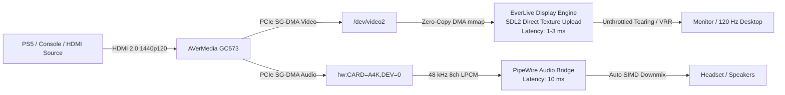

# EverLive - AVerMedia GC573 Linux Gaming Suite & Open Driver

[](#)
[](#current-status)
[-2e7d32.svg)](#native-open_gc573-driver)
[](#everlive-gaming-suite-playsh)
[-2e7d32.svg)](#hardware-and-kernel-compatibility)
[](#legal-and-licensing)

**EverLive** is an all-in-one Linux console gaming suite and native open-source driver ecosystem for the **AVerMedia Live Gamer 4K (GC573)** (PCI `1461:0054`, Subsystem `1461:5730`) and **Live Gamer BOLT (GC555)** (`1461:5550`).

With **EverLive**, you can play PlayStation 5, Xbox Series X, or Nintendo Switch directly on your Linux desktop (Wayland & X11) at **true 1440p @ 120 FPS** with **sub-frame latency (< 3 ms)** — featuring synchronized surround audio, real-time in-game volume controls, and desktop application launcher integration without having to switch HDMI cables on your monitor.

---

## 🚀 Quickstart: 1-Click Installation (Beginner-Friendly)

> **Is installation easy for Linux beginners?**  
> **Yes, extremely easy!** You don't need prior experience with kernel headers, udev permissions, or DKMS. Our installer handles everything automatically in a single step.

### 1-Command Installation

Open a terminal and run:

```bash
git clone https://github.com/Everlite/EverLive.git
cd EverLive
./install.sh
```

### What the installer handles automatically:
1. **Auto-Detects Your Distribution:** Automatically identifies your package manager (`pacman` on Arch/CachyOS/Manjaro, `apt` on Ubuntu/Debian/Mint/Pop!_OS, or `dnf` on Fedora/Nobara) and installs any missing build headers or libraries.
2. **Compiles Driver & Display App:** Builds the clean `open_gc573` kernel module and compiles the high-performance C direct display engine (`everlive_display`).
3. **DKMS Protection Against Kernel Updates:** If DKMS is available, it registers the module so that future Linux kernel updates will automatically recompile the driver in the background — your setup will never break after a system update.
4. **No Root Privileges Needed to Play (udev):** Sets up `/etc/udev/rules.d/70-everlive.rules` with `TAG+="uaccess"`. Normal desktop users get immediate read/write access to capture video and audio without ever needing `sudo`.
5. **Start Menu Integration:** Installs the desktop launcher into your application menu (KDE Plasma, GNOME, etc.).

After installation, simply launch the game screen from your application menu (**EverLive**) or run:
```bash
./play.sh
```

---

## Highlights & Verified Capabilities

- **2560×1440 @ 120 FPS Verified on PlayStation 5:** 120.35 Hz HDMI 2.0 capture verified on real PS5 hardware (*The Finals*, *Fortnite 120Hz Mode*, PS5 Dashboard).
- **Sub-Frame Input Latency (< 3 ms Lag):** Built-in native C direct rendering engine (`everlive_display`) maps V4L2 DMA buffers directly to GPU textures (SDL2 unthrottled presentation / Wayland tearing). No demuxer, no frame buffering, no video player lag.
- **Synchronized 8-Channel Surround Audio:** Captures console uncompressed 8-channel 48 kHz LPCM HDMI audio and streams it to your headset or speakers via PipeWire with **10 ms latency**.
- **In-Game HUD & Live Volume Control:**
  - Adjust volume anytime during gameplay using the **mouse wheel**.
  - Interactive on-screen HUD volume slider in the top-left corner + mute button.
  - Hotkeys: <kbd>F11</kbd> for borderless fullscreen, <kbd>m</kbd> for mute, <kbd>Tab</kbd> for live performance and jitter stats.
- **100% Blob-Free Option:** The primary driver `open_gc573` is 100% open-source (**GPL-2.0**), contains no proprietary `.a` binaries, and compiles cleanly on Linux kernels 6.19 through 7.x.

---

## Video Demonstration (PS5 Gameplay & Latency)

Live gameplay capture demonstration of **THE FINALS** on PlayStation 5 played through EverLive on Linux desktop:

https://github.com/Everlite/EverLive/raw/main/docs/thefinals_demo.mp4

[](https://github.com/Everlite/EverLive/raw/main/docs/thefinals_demo.mp4)

*(Click the player or preview image above to view the gameplay demonstration)*

---

## Architecture



---

## Repository Structure

| Directory / File | Description |
|:---|:---|
| **`install.sh`** | 1-Click universal installer (driver build, udev permissions, autostart, desktop launcher). |
| **`uninstall.sh`** | Clean uninstaller that removes all installed driver and configuration files. |
| **`play.sh`** | Quick launcher for desktop and command-line usage. |
| **`open_gc573/`** | **Primary Driver:** Native, 100% blob-free Linux kernel driver (GPL-2.0-only). |
| **`tools/everlive/`** | **EverLive Gaming Suite:** Direct C display engine (`everlive_display.c`), Qt launcher (`everlive_viewer.py`), and desktop entry. |
| **`legacy/cx511h_blob/`** | **Legacy Archive:** Original AVerMedia vendor wrapper with binary blob (`AverMediaLib_64.a`) preserved for historical reference. |

---

## Controls & Hotkeys During Gameplay

The following controls are available inside the game window:

| Key / Action | Function |
|:---|:---|
| **Mouse Wheel Up / Down** | Adjust volume smoothly up / down (with on-screen toast display) |
| **HUD Volume Slider** | Drag the slider in the top-left corner with the mouse |
| <kbd>m</kbd> | Toggle audio mute / unmute |
| <kbd>F11</kbd> or <kbd>f</kbd> | Toggle borderless fullscreen (or double-click the window) |
| <kbd>Tab</kbd> or <kbd>i</kbd> | Toggle on-screen statistics (FPS, PCIe latency, jitter) |
| <kbd>+</kbd> / <kbd>-</kbd> or <kbd>↑</kbd> / <kbd>↓</kbd> | Adjust volume in 5% increments |
| <kbd>Esc</kbd> or <kbd>q</kbd> | Exit game window |

*Note: The mouse cursor and HUD automatically fade out after 2.5 seconds of inactivity so your view remains completely unobstructed.*

---

## ⚠️ Performance Note: Frame Pacing, Jitter & Work in Progress

> [!NOTE]
> **EverLive is an active work in progress.** While 1440p @ 120 FPS is fully functional and playable with sub-3ms display latency, it is **not yet 100% perfect**:
>
> - **Occasional Jitter & Micro-Stutter:** Depending on desktop compositor activity (KDE Wayland / GNOME), background CPU load, and GPU presentation timing, slight frame pacing jitter (typically 1–10 ms variance) can occasionally occur.
> - **Fluctuating 120 FPS Cadence:** The capture hardware's native HDMI clock runs at ~120.35 Hz. If your monitor is configured for a fixed refresh rate without Variable Refresh Rate (VRR), minor cadence mismatches can cause subtle micro-stutter during fast camera sweeps.
> - **Active Development:** We are continuously optimizing the FPGA DMA queue depth, buffer recycling intervals, and Wayland presentation synchronization to achieve completely flat frame pacing. Improvements are actively being worked on!
>
> **Tips for the best gaming experience:**
> 1. **Enable VRR / Adaptive Sync:** In your desktop display settings (e.g. KDE Plasma *System Settings -> Display -> Adaptive Sync -> Always*), enable VRR so your display seamlessly syncs to incoming capture frames.
> 2. **Set Monitor to ≥ 120 Hz:** Ensure your Linux desktop refresh rate is set to 120 Hz or higher. Displaying a 120 FPS capture stream on a 60 Hz monitor will inevitably drop frames.
> 3. **Wayland Tearing:** EverLive automatically enables `SDL_VIDEO_WAYLAND_TEARING=1` for unthrottled, zero-delay presentation.

---

## Hardware and Kernel Compatibility

- **Capture Card:** AVerMedia Live Gamer 4K (GC573) / Live Gamer BOLT (GC555)
- **PCI IDs:** `1461:0054`, Subsystem `1461:5730` (GC573 PCIe) or `1461:5550` (GC555 Thunderbolt)
- **Linux Kernels:** Fully compatible with Linux 6.19 through 7.x (tested on CachyOS Linux 7.2.8 & Arch Linux).
- **Desktop Environments:** Wayland (KDE Plasma 6, GNOME) and X11.

---

## Troubleshooting & FAQ

#### 1. Black screen or "No Signal"
- **Disable HDCP:** On PlayStation 5, go to **Settings -> System -> HDMI -> Enable HDCP** and switch it **OFF**. (Capture cards cannot decode encrypted HDCP video signals).
- **Cable Connection:** Ensure the console's HDMI cable is connected to **HDMI IN** on the card (the port closest to the motherboard PCIe bracket).
- **Check Lock Status:** Verify the card has locked onto the signal: `v4l2-ctl -d /dev/video2 --query-dv-timings`.

#### 2. No sound output
- Ensure audio is not muted inside the EverLive window (press <kbd>m</kbd> or scroll the mouse wheel up).
- In your KDE/GNOME audio settings under "Applications", ensure the stream **`gc573-audio`** is active and unmuted.

#### 3. How do I uninstall EverLive?
Run the uninstaller inside the repository directory:
```bash
sudo ./uninstall.sh
```

---

## Legal and Licensing

| Component | Path | License | Notes |
|:---|:---|:---:|:---|
| **Native Kernel Driver** | `open_gc573/` | **GPL-2.0-only** | Derived from clean-room reverse-engineering by ostrich ([gc555](https://github.com/ostrich/gc555)). Extended by Everlite. 100% Free Software. |
| **EverLive Gaming Suite** | `tools/everlive/`, `play.sh`, `install.sh` | **MIT** | Copyright © 2026 Everlite. Direct C display renderer and Qt control center. |
| **Legacy Blob Archive** | `legacy/cx511h_blob/` | **Mixed** | Wrapper: MIT / `AverMediaLib_64.a`: Proprietary (AVerMedia Technologies, Inc.). Isolated in the legacy archive. |

### Disclaimers & Trademark Notice

- **Trademarks:** AVerMedia, Live Gamer 4K (GC573), and Live Gamer BOLT (GC555) are trademarks or registered trademarks of AVerMedia Technologies, Inc. PlayStation, PS4, and PS5 are registered trademarks of Sony Interactive Entertainment Inc. All product names, trademarks, and registered trademarks are property of their respective owners and are used solely for hardware identification and compatibility purposes. This independent open-source project is not affiliated with, authorized, maintained, sponsored, or endorsed by AVerMedia Technologies, Inc., Sony, or any of their affiliates.
- **Warranty:** This software and documentation are provided "AS IS", without warranty of any kind, express or implied, including but not limited to the warranties of merchantability, fitness for a particular purpose, and non-infringement. In no event shall the authors or contributors be liable for any claim, damages, or other liability arising from the use of this software. Register tuning, EDID flashing, and kernel driver interactions are performed at your own risk.

---

## Acknowledgements

- **[Everlite](https://github.com/Everlite)** — Project initiator, EverLive gaming suite, PS5 1440p120 hardware tuning, low-latency direct renderer & PipeWire audio supervisor.
- **[ostrich](https://github.com/ostrich)** — Author of the [gc555](https://github.com/ostrich/gc555) driver, whose clean-room reverse-engineering of the Artix-7 VIP registers and FPGA DMA ring laid the foundation for `open_gc573`.
- **[Lou Perret](https://github.com/lou-perret)** — Continuous capture stabilization, ALSA audio constraints, and 4K VM measurements.
- **[derrod](https://github.com/derrod)** — Pioneering initial Linux reverse-engineering on AVerMedia capture devices.
