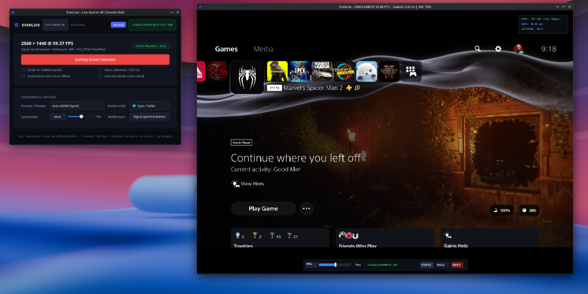
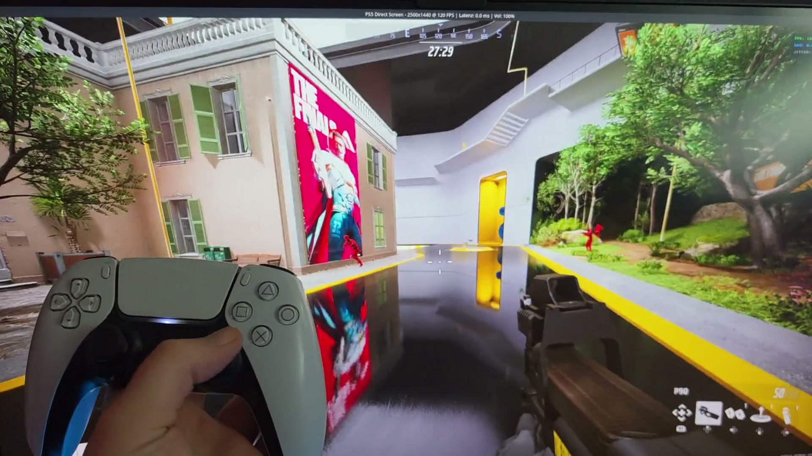
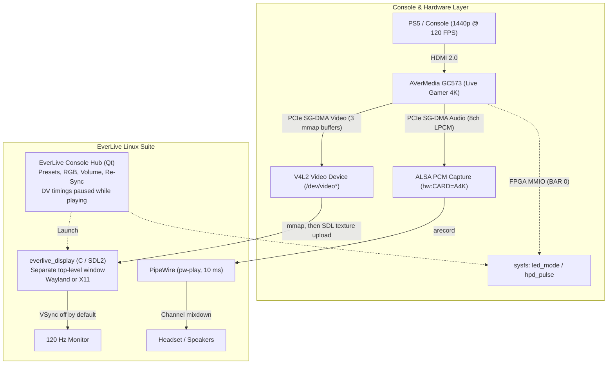

# EverLive - AVerMedia GC573 Linux Gaming Suite & Open Driver

[](#)
[](https://discord.com/invite/D2XFhkPMmc)
[-brightgreen.svg)](#highlights--verified-capabilities)
[-2e7d32.svg)](#hardware-and-kernel-compatibility)
[](#-hardware-rgb-led-lighting-on-the-fly-control)
[](#-everlive-console-hub--game-window)
[-2e7d32.svg)](#hardware-and-kernel-compatibility)
[](#-transparency--ai-assistance)
[](#legal-and-licensing)

**EverLive** is an all-in-one Linux console gaming suite and 100% blob-free open-source driver for the **AVerMedia Live Gamer 4K (GC573)** (PCI `1461:0054`, Subsystem `1461:5730`) and **Live Gamer BOLT (GC555)** (`1461:5550`).

With **EverLive**, you can play PlayStation 5, Xbox Series X, Nintendo Switch, or PCs directly on your Linux desktop (Wayland & X11) at **1440p @ 120 FPS**. HDMI capture at 1440p and 120.35 Hz is verified on a PlayStation 5. How smooth that looks on the monitor still depends on the panel clock. That part is experimental; see [Known Issues](#️-known-issues--work-in-progress). EverLive also provides synchronized multi-channel audio, live volume control, hardware RGB control, and start-menu integration.

---

## 🚀 Quickstart: 1-Click Installation (Beginner-Friendly)

> **Is installation easy for Linux beginners?**  
> **Yes.** You don't need prior experience with kernel headers, udev permissions, or DKMS. The installer handles everything in a single step.

### 1-Command Installation

Open a terminal and run:

```bash
git clone https://github.com/Everlite/EverLive.git
cd EverLive
sudo ./install.sh
```

### What the installer does:
1. **Detects your distribution and dependencies:** Detects your package manager (`pacman` on Arch/CachyOS/Manjaro, `apt` on Ubuntu/Debian/Mint/Pop!_OS, `dnf` on Fedora/Nobara), lists missing packages (kernel headers, build tools, SDL2, PipeWire/ALSA tools, `v4l-utils`, mpv, Qt XCB cursor libs) and offers to install them.
2. **Sets up Python (PySide6):** If PySide6 is not available system-wide (e.g. Debian, Ubuntu, Linux Mint), it creates a local virtual environment (`tools/everlive/.venv`) so the hub runs without touching system Python.
3. **Compiles the driver and display engine:** Builds the `open_gc573` kernel module and the native C display engine (`everlive_display`).
4. **DKMS support for kernel updates:** If DKMS is installed, the module is registered so it is rebuilt automatically after kernel updates.
5. **Loads the driver at boot:** Adds `open_gc573` to `/etc/modules-load.d/everlive.conf`.
6. **Sets permissions so you can play without root:** Installs `/etc/udev/rules.d/70-everlive.rules` (`TAG+="uaccess"` for video/audio, group `video` for the RGB and HDMI re-sync sysfs files) and adds your user to the `video` and `audio` groups. *Log out and back in once after installing so the group change takes effect.*
7. **Adds a start menu entry:** Installs the **EverLive** desktop launcher (and removes the old `gc573-ps5.desktop` launcher if present).

After installation, launch **EverLive** from your application menu, or run:
```bash
./play.sh
```
*If the driver isn't loaded yet, `play.sh` loads it for you (it asks for your password once via `pkexec`).*

---

## Highlights & Verified Capabilities

- **2560×1440 @ 120 FPS verified on PlayStation 5:** 120.35 Hz HDMI 2.0 capture verified on real PS5 hardware (*The Finals*, *Fortnite 120Hz Mode*, PS5 Dashboard).
- **Retro scalers & non-integer refresh rates (RetroTINK 4K, 59.94 Hz NTSC / 50 Hz PAL):** A measured rate within ±2 Hz of a mode in the driver's table is accepted. The Console Hub and game window HUD print refresh rates to two decimal places (e.g. `59.94 FPS (16.68ms)`). Supports custom and high refresh modes including `3840x1080` (RetroTINK 4K 120Hz BFI mode), `1920x1080 @ 180Hz`, and `1920x1200` WUXGA.
- **Graceful Standby & Auto-Connect:** If launched before the console or video source is powered on or connected, the game window opens immediately displaying a clean Standby screen (*"Warte auf HDMI-Signal..."*) instead of exiting, and seamlessly transitions into active video playback once the HDMI handshake completes.
- **Hot Resolution Switching:** If the console or scaler changes output resolution during active playback (e.g. 4K Dashboard $\leftrightarrow$ 1440p 120Hz $\leftrightarrow$ 1080p), the game window detects the new timings, re-allocates V4L2 buffers and GPU textures on the fly, and resumes playback without black-screening or requiring a window restart.
- **Low-latency direct rendering (experimental):** `everlive_display` asks for a 3-buffer V4L2 queue. While playback stays under the threshold it shows frames in order. If the time since the DMA timestamp exceeds about 18 ms at 120 Hz, or about 32 ms at 60 Hz, it skips one queued frame. It does not empty the whole queue in one step.
- **Separate console hub + game window (no more X11 embedding):**
  - **Why the hub no longer embeds the video:** Earlier versions passed the Qt widget to `everlive_display -w` (`SDL_CreateWindowFrom`) and forced the X11 video driver. On Wayland that path runs through Xwayland. The nested window is composited with the hub, and a size check in the renderer called `SDL_SetWindowSize` on that foreign window. The Console Hub does not pass `-w` anymore. The flag still exists on the renderer.
  - **How it works now:** The **EverLive Console Hub** (Qt, runs natively on Wayland) handles setup: signal status, format preset, RGB LED, volume, HDMI re-sync and launch options. The video stream runs in its **own top-level window** (`everlive_display`, SDL2) that talks to the compositor directly.
  - **Native Wayland window:** If your SDL2 comes from **sdl2-compat / SDL3** (e.g. Arch, CachyOS), the game window is a native Wayland client. With classic SDL2 builds (e.g. older Ubuntu/Mint releases), SDL uses X11 by default, so on Wayland it runs through Xwayland. On X11 sessions it always runs natively.
  - **Non-blocking presentation:** VSync is off by default. Frames are presented as soon as they arrive and never wait for vblank. In fullscreen, compositors such as KWin can use direct scanout automatically. VSync can be turned on in the hub if you prefer.
  - **No HDMI polling while you play:** While the game window is open, the hub does not query DV timings. That avoids a once-per-second stall on the HDMI receiver's I2C bus. It still reads the cached `hdr_mode` control once a second, so the label can follow an HDR change.
- **Aspect-ratio-preserving scaling (letterbox / pillarbox):** Keeps the source aspect ratio on 16:10, 21:9 and 4:3 setups with black borders and no stretching, in both windowed and fullscreen mode.
- **Live HDR switching:** HDR10 (PQ) and HLG come from the HDMI DRM InfoFrame. At the same resolution the driver updates the color matrix only and leaves DMA running, so the game window stays up. The Console Hub label follows that metadata (`SDR`, `HDR10`, or `HLG`). Switching HDR on a PlayStation 5 during capture was verified. The pixels stay in the selected capture format (usually YUYV); PQ and HLG are not tone-mapped to SDR. P010 is the 10-bit capture format.
- **Direct render pipeline:** `everlive_display` maps the V4L2 DMA buffers and uploads each frame to an SDL2 OpenGL texture (`SDL_UpdateTexture`). The HUD latency number is taken before that upload and before `SDL_RenderPresent`. It is not the time until the panel shows the frame.
- **Multi-channel audio (7.1, 5.1 & stereo):** Captures console LPCM audio from ALSA (tries 8ch, then 6ch, then 2ch; falls back to `plughw` automatically) and plays it through PipeWire (`pw-play`, 10 ms latency target) as the stream **`gc573-audio`**. PipeWire mixes it down to your stereo headset or surround setup.
- **Hardware RGB LED control (reverse-engineered):**
  - **Factory blinking fixed:** Reverse-engineered the Artix-7 FPGA lighting engine (BAR 0 `0x0800`–`0x086c`, script RAM `0x2008`). The card no longer blinks red endlessly on Linux, and you don't need Windows software.
  - **No dropped frames, no password prompts:** The sysfs attribute `led_mode` is writable by the `video` group (`0660`). After installing, you can change colors from the hub or the CLI without `sudo`. Changes are applied via direct register writes, with no stream restart and no dropped frames.
  - **8 hardware profiles:** Off (Dark), Blue, Green, Red, Cyan, Magenta, Yellow and White.
  - **Boot persistence:** Set via `/etc/modprobe.d/open_gc573.conf`.
- **In-game HUD & live volume control:**
  - Change the volume (0–150%) with the **mouse wheel**, the keyboard, the on-screen HUD slider, or the hub slider. All of them work while you play.
  - Stats overlay (FPS, latency, jitter), **on by default**, top right of the game window. <kbd>Tab</kbd> or <kbd>i</kbd> hides it. The same line is printed to the terminal once per second. The latency figure is the time from DMA completion to dequeue, before the texture upload and the present.
- **100% blob-free:** `open_gc573` and the whole repository are open source under **GPL-2.0-only**. The repository contains no proprietary binary blobs.

---

## 🎮 EverLive Console Hub & Game Window



*Console Hub on the desktop, capture in its own window. The hub does not embed the video.*

**Console Hub (`everlive_viewer.py`):**
- Live HDMI signal status capsule (e.g. `● 2560x1440 @ 120 FPS • SDR`)
- Format preset (Auto / 1440p120 / 1080p120 / 1080p60 / 2160p60 …)
- Hardware RGB LED dropdown with live color previews, volume slider + mute, **Signal synchronisieren** button
- **Gaming Screen starten** with options: *start in fullscreen* (checked by default), *open automatically on launch*, *enable VSync*, *Streamer Mode (Clean Feed)*

**Command-line options:**
```bash
./play.sh -f                 # start the game window immediately (fullscreen)
./play.sh -s                 # start in Streamer Mode (clean feed without overlays)
./play.sh --cli -f           # no GUI, game window only
./play.sh --vsync            # enable VSync
./play.sh --led off          # set RGB LED and exit
./play.sh -d /dev/video0 -a hw:CARD=A4K,DEV=0   # override auto-detected devices
./play.sh --mpv              # use mpv instead of everlive_display (fallback)
```

You can also start the renderer directly, without the hub: `./tools/everlive/everlive_display -f`

---

## Video Demonstration (PS5 Gameplay & Latency)

Live gameplay demonstration of **THE FINALS** on PlayStation 5 played through EverLive on the Linux desktop:

https://github.com/Everlite/EverLive/raw/main/docs/thefinals_demo.mp4

[](https://github.com/Everlite/EverLive/raw/main/docs/thefinals_demo.mp4)

*(Click the player or preview image above to watch the demonstration)*

---

## Architecture



---

## Repository Structure

| Directory / File | Description |
|:---|:---|
| **`install.sh`** | One-click installer (dependencies, driver build, DKMS, udev permissions, boot autoload, desktop launcher). |
| **`uninstall.sh`** | Uninstaller that removes the driver, DKMS entry, udev rules, autoload config and launcher. |
| **`play.sh`** | Launcher used by the start menu entry; loads the driver if needed, then starts the Console Hub. |
| **`open_gc573/`** | **Kernel driver:** native, blob-free Linux driver (GPL-2.0-only), plus `load.sh` / `unload.sh`. |
| **`tools/everlive/`** | **EverLive suite:** Console Hub (`everlive_viewer.py`), native display engine (`everlive_display.c`), desktop entry. |

---

## Controls & Hotkeys During Gameplay

These controls work inside the game window:

| Key / Action | Function |
|:---|:---|
| **Mouse Wheel Up / Down** | Volume up / down in 5% steps (with an on-screen notice) |
| **HUD Volume Slider** | Drag the slider in the bar at the bottom center of the window |
| <kbd>s</kbd> or <kbd>F10</kbd> | Toggle **Streamer Mode (Clean Feed)** — locks overlays, hides cursor & suppresses HUD for OBS capture |
| <kbd>m</kbd> | Mute / unmute audio |
| <kbd>F11</kbd> or <kbd>f</kbd> (or double-click) | Toggle borderless fullscreen |
| <kbd>Tab</kbd> or <kbd>i</kbd> | Show / hide the stats overlay (FPS, latency, jitter) |
| <kbd>h</kbd> or <kbd>r</kbd> | Force HDMI handshake & re-sync video timings |
| <kbd>+</kbd> / <kbd>-</kbd>, <kbd>↑</kbd> / <kbd>↓</kbd> or <kbd>0</kbd> / <kbd>9</kbd> | Volume up / down in 5% steps (0–150%) |
| <kbd>Esc</kbd> or <kbd>q</kbd> | Close the game window |

*Note: The mouse cursor and HUD fade out after 2.5 seconds without input so nothing blocks your view. In Streamer Mode (<kbd>s</kbd>), all overlays and cursor popups are hard-disabled for clean capture.*

---

## 💡 Hardware RGB LED Lighting (On-the-Fly Control)

On Windows, the GC573 needs AVerMedia's background software to stop its unconfigured factory state (endless red blinking). On Linux, this used to leave the card blinking inside the PC case permanently.

Through reverse-engineering of the official firmware and the FPGA register space, **EverLive has full native control over the card's RGB lighting**:

### Key Advantages
* **No gameplay interruption:** Changing colors is a simple register write. It doesn't renegotiate HDMI, reset DMA, or drop frames. Tested live on PS5 during 1440p @ 120 FPS gameplay.
* **No sudo needed:** `led_mode` is writable by the `video` group (`0660`, set by the driver and the udev rule). The installer adds your user to that group.
* **8 hardware profiles:**
  - `0`: 🌑 **Off (Dark)**, the driver default at load time unless you set `led_mode` (see below). If the Console Hub has no saved color, opening it writes mode `1` (blue).
  - `1`: 🔵 **Solid Blue**
  - `2`: 🟢 **Solid Green**
  - `3`: 🔴 **Solid Red**
  - `4`: 🔷 **Cyan / Turquoise**
  - `5`: 🟣 **Magenta / Purple**
  - `6`: 🟡 **Yellow**
  - `7`: ⚪ **White**
* **Live switching in the GUI:** Pick a color at any time from the LED dropdown in the Console Hub.
* **Command line:**
  ```bash
  ./play.sh --led off
  ./play.sh --led blue
  ./play.sh --led cyan
  ```

### Boot Persistence
To make the card start in your preferred color as soon as the driver loads, **without opening EverLive**:

```bash
# Card stays dark at boot:
echo "options open_gc573 led_mode=0" | sudo tee /etc/modprobe.d/open_gc573.conf

# Card lights up solid blue at boot:
echo "options open_gc573 led_mode=1" | sudo tee /etc/modprobe.d/open_gc573.conf
```

---

## ⚠️ Known Issues & Work in Progress

> [!NOTE]
> **EverLive is a work in progress.** 1440p @ 120.35 Hz capture is verified on a PlayStation 5. Pacing on the monitor is still **experimental**:
>
> - **HDMI mode switches (resolution & refresh rate changes):** When a game or console changes resolution or refresh rate (e.g. from 60 Hz PS5 home menu to 120 Hz in *The Finals*), the game window automatically detects the new timings and re-allocates video buffers.
>   - **Hardware HPD re-sync:** If the HDMI receiver or console stalls while switching clock rates, press <kbd>h</kbd> or <kbd>r</kbd> in the game window (or click **🔄 HDMI Re-Sync** in the Console Hub). This sends a hardware HPD (Hot-Plug Detect) pulse via sysfs, forcing an immediate, clean handshake without touching physical cables.
> - **Refresh-rate mismatch (120.35 Hz vs. 120.00 Hz):** The PS5 outputs ~120.35 Hz. On a fixed 120.00 Hz monitor with **VSync enabled**, the extra 0.35 frames per second build up, and one frame is dropped about every 3 seconds. With VSync off (default), presentation doesn't wait for vblank, so this doesn't happen.
> - **SDL backend:** The game window runs natively on Wayland only with sdl2-compat / SDL3. With classic SDL2 it runs through Xwayland (see *Highlights*). You can force a backend with `SDL_VIDEODRIVER=wayland` or `SDL_VIDEODRIVER=x11`.
> - **Active development:** DMA queue tuning, buffer recycling and HDMI audio compatibility across more sources are still being improved.
>
> **Tips for the best experience:**
> 1. **Keep VSync off** (default) unless you see tearing that bothers you.
> 2. **Try VRR / Adaptive Sync:** Depending on your GPU driver, compositor and monitor (e.g. KDE Plasma *System Settings → Display → Adaptive Sync → Always*), VRR can smooth out pacing by matching the refresh rate to the incoming frames. *How well this works depends on your compositor.*
> 3. **Set your monitor to ≥ 120 Hz:** A 120 FPS stream on a 60 Hz desktop will always drop frames.
> 4. **Use fullscreen:** Fullscreen gives the compositor the best chance to use direct scanout.

---

## Hardware and Kernel Compatibility

| Device | Interface | PCI Subsystem | Support Status | Notes |
|:---|:---|:---:|:---:|:---|
| **AVerMedia Live Gamer 4K (GC573)** | PCIe Gen2 x4 | `1461:5730` | **Verified on Hardware** | Tested with PlayStation 5 (1440p120, 1080p, 4K60) and RetroTINK 4K Pro (59.94 Hz NTSC). |
| **AVerMedia Live Gamer BOLT (GC555)** | Thunderbolt 3 | `1461:5550` | **Should work (untested)** | Code inherited from ostrich's clean-room driver; not yet tested on real hardware by Everlite. Testers welcome! |

- **Linux distributions tested:** CachyOS, Arch Linux, Linux Mint 22.3 (Cinnamon), Ubuntu, Debian.
- **Linux kernels:** Linux 6.19 through 7.x (tested from 7.0 generic up to CachyOS 7.2.9).
- **Desktop environments:** Main test setup is KDE Plasma 6 on Wayland (CachyOS, sdl2-compat → native Wayland game window). Also used on X11 (Cinnamon, XFCE). Other Wayland compositors (GNOME, Hyprland, Sway) should work but haven't been tested yet.

---

## Troubleshooting & FAQ

#### 1. Black screen or "No Signal"
- **Disable HDCP:** On PlayStation 5, go to **Settings → System → HDMI → Enable HDCP** and turn it **OFF**. Capture cards can't record HDCP-encrypted video.
- **Cable connection:** Connect the console to the card's **HDMI IN** port (the one closest to the motherboard).
- **Check lock status:** Find the device with `v4l2-ctl --list-devices`, then check whether the card has locked onto the signal: `v4l2-ctl -d /dev/videoX --query-dv-timings`.

#### 2. No sound output
- Make sure audio isn't muted in the game window (press <kbd>m</kbd> or scroll the mouse wheel up).
- In your KDE/GNOME sound settings under "Applications", make sure the stream **`gc573-audio`** is active and not muted.

#### 3. Signal lost after launching or closing a game (mode / refresh rate switch)
- **Symptom:** The screen goes black or loses signal when switching between the 60 Hz console menu and a 120 Hz game (e.g. *The Finals*), or when the source changes video mode.
- **Fix (software re-sync):** Press <kbd>h</kbd> or <kbd>r</kbd> in the game window, or click **🔄 HDMI Re-Sync** in the Console Hub. EverLive renegotiates HDMI and picks up the new timings right away. You usually don't need to unplug the cable.
- **Last resort:** Only if the HDMI receiver stops responding completely, briefly unplug and replug the HDMI cable at the capture card.

#### 4. RGB / Re-Sync does nothing ("Permission denied")
- Log out and back in after installing so your new `video` group membership takes effect. Check with `groups`.

#### 5. Stutter or lag: how do I measure it?
- Start the renderer from a terminal: `./tools/everlive/everlive_display -f`. Once per second it prints the measured FPS, latency and jitter. Press <kbd>Tab</kbd> to see the same values in the game window. Include this output when you open an issue.

#### 6. Secure Boot: "Loading of unsigned module is rejected"
- **Symptom:** With UEFI Secure Boot enabled (e.g. Ubuntu, Linux Mint, Fedora), the kernel may refuse to load out-of-tree drivers with `Loading of unsigned module is rejected` or `module verification failed`.
- **Solution:**
  1. **Option A (simplest):** Disable **Secure Boot** in your UEFI/BIOS settings.
  2. **Option B (keep Secure Boot on):** Sign `open_gc573.ko` with your Machine Owner Key (MOK):
     ```bash
     # Generate a MOK key pair (if you don't have one already):
     openssl req -new -x509 -newkey rsa:2048 -keyout MOK.priv -outform DER -out MOK.der -nodes -days 36500 -subj "/CN=EverLive MOK/"
     
     # Import the key into your system MOK list (prompts for a one-time password):
     sudo mokutil --import MOK.der
     # (Reboot your PC and follow the blue MOK management screen to enroll the key)

     # Sign the installed driver module (sign-file path shown for Debian/Ubuntu):
     sudo /usr/src/linux-headers-$(uname -r)/scripts/sign-file sha256 MOK.priv MOK.der $(modinfo -n open_gc573)
     ```

#### 7. How do I uninstall EverLive?
Run the uninstaller in the repository folder:
```bash
sudo ./uninstall.sh
```

---

## 💬 Community & Discord

Have questions, want to share your hardware setup, or discuss compatibility across different consoles, monitors, and Linux distributions?

Join our official community on Discord:  
👉 **[Join the EverLive Discord Server](https://discord.com/invite/D2XFhkPMmc)**

* Share logs, `dmesg` outputs, and hardware configs
* Get help setting up PS5, Xbox Series X, Switch, or RetroTINK
* Chat about upcoming driver milestones and latency tuning

---

## Legal and Licensing

| Component | Path | License | Notes |
|:---|:---|:---:|:---|
| **Kernel Driver** | `open_gc573/` | **GPL-2.0-only** | Based on clean-room reverse-engineering by ostrich ([gc555](https://github.com/ostrich/gc555)), extended by Everlite. |
| **EverLive Gaming Suite** | `tools/everlive/`, `play.sh`, `install.sh`, `uninstall.sh` | **GPL-2.0-only** | Copyright © 2026 Everlite. Native C display engine and Qt Console Hub. See [`LICENSE.md`](LICENSE.md). |

### Disclaimers & Trademark Notice

- **Trademarks:** AVerMedia, Live Gamer 4K (GC573) and Live Gamer BOLT (GC555) are trademarks or registered trademarks of AVerMedia Technologies, Inc. PlayStation, PS4 and PS5 are registered trademarks of Sony Interactive Entertainment Inc. All product names and trademarks belong to their respective owners and are used only to identify hardware and compatibility. This independent open-source project is not affiliated with, authorized, maintained, sponsored, or endorsed by AVerMedia Technologies, Inc., Sony, or any of their affiliates.
- **Warranty:** This software and documentation are provided "AS IS", without warranty of any kind, express or implied, including but not limited to the warranties of merchantability, fitness for a particular purpose, and non-infringement. In no event shall the authors or contributors be liable for any claim, damages, or other liability arising from the use of this software. Register tuning, EDID flashing, and kernel driver interactions are performed at your own risk.

---

## Acknowledgements

- **[Everlite](https://github.com/Everlite)**: Project initiator; EverLive gaming suite, PS5 1440p120 hardware tuning, low-latency direct renderer and PipeWire audio.
- **[ostrich](https://github.com/ostrich)**: Author of the [gc555](https://github.com/ostrich/gc555) driver. His clean-room reverse-engineering of the Artix-7 registers and the FPGA DMA ring is the foundation of `open_gc573`.
- **[Lou Perret](https://github.com/lou-perret)**: Capture stability fixes, ALSA audio constraints and 4K VM measurements.
- **[derrod](https://github.com/derrod)**: Early Linux reverse-engineering work on AVerMedia capture devices.

### 🤖 Transparency & AI Assistance

In the spirit of open-source transparency: **this project is heavily AI-assisted**.
The project owner (Everlite) directed the project, tested on physical hardware (PlayStation 5, monitor timings, audio sync), analyzed hardware behavior and validated performance. The code, refactoring, scripts and debugging were written and iterated with generative AI / LLM coding agents.
