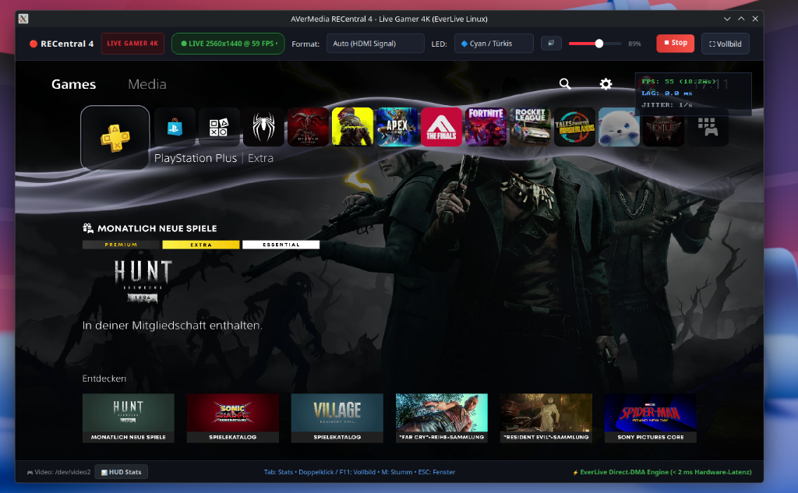

# EverLive - AVerMedia GC573 Linux Gaming Suite & Open Driver

[](#)
[-brightgreen.svg)](#highlights--verified-capabilities)
[-2e7d32.svg)](#native-open_gc573-driver)
[](#-hardware-rgb-led-lighting-on-the-fly-control)
[](#everlive-gaming-suite-playsh)
[-2e7d32.svg)](#hardware-and-kernel-compatibility)
[](#transparency--ai-assistance)
[](#legal-and-licensing)

**EverLive** is an all-in-one Linux console gaming suite and 100% blob-free open-source driver ecosystem for the **AVerMedia Live Gamer 4K (GC573)** (PCI `1461:0054`, Subsystem `1461:5730`) and **Live Gamer BOLT (GC555)** (`1461:5550`).

With **EverLive**, you can play PlayStation 5, Xbox Series X, Nintendo Switch, or PCs directly on your Linux desktop (X11 & Wayland via Xwayland) at **true 1440p @ 120 FPS** with ultra-low internal render latency. In physical tests on PS5, the direct renderer achieves smooth, responsive frame delivery (*still experimental*), featuring synchronized multi-channel surround audio, real-time volume controls, and seamless desktop application launcher integration.

---

## 🚀 Quickstart: 1-Click Installation (Beginner-Friendly)

> **Is installation easy for Linux beginners?**  
> **Yes, extremely easy!** You don't need prior experience with kernel headers, udev permissions, or DKMS. Our installer handles everything automatically in a single step.

### 1-Command Installation

Open a terminal and run:

```bash
git clone https://github.com/Everlite/EverLive.git
cd EverLive
./install.sh
```

### What the installer handles automatically:
1. **Auto-Detects Your Distribution:** Automatically identifies your package manager (`pacman` on Arch/CachyOS/Manjaro, `apt` on Ubuntu/Debian/Mint/Pop!_OS, or `dnf` on Fedora/Nobara) and installs missing build tools and libraries (including SDL2, PipeWire, ALSA, mpv, and Qt XCB cursor dependencies like `libxcb-cursor0`).
2. **Automated Python Environment (PySide6):** On distributions without system-packaged PySide6 (such as Debian, Ubuntu, and Linux Mint), the installer automatically provisions a dedicated local virtual environment (`tools/everlive/.venv`) so EverLive Studio launches seamlessly out of the box without polluting system Python.
3. **Compiles Driver & Display App:** Builds the clean `open_gc573` kernel module and compiles the high-performance C direct display engine (`everlive_display`).
4. **DKMS Support for Kernel Updates:** If DKMS is installed on your system, it registers the module so that supported Linux kernel updates automatically rebuild the driver in the background.
5. **No Root Privileges Needed to Play (udev):** Sets up `/etc/udev/rules.d/70-everlive.rules` with `TAG+="uaccess"`. Normal desktop users get immediate read/write access to capture video, audio, and on-the-fly RGB controls without ever needing `sudo`.
6. **Start Menu Integration:** Installs the desktop launcher into your application menu (KDE Plasma, GNOME, Cinnamon, etc.).

After installation, simply launch the game screen from your application menu (**EverLive**) or run:
```bash
./play.sh
```

---

## Highlights & Verified Capabilities

- **2560×1440 @ 120 FPS Verified on PlayStation 5:** 120.35 Hz HDMI 2.0 capture verified on real PS5 hardware (*The Finals*, *Fortnite 120Hz Mode*, PS5 Dashboard).
- **Retro Scalers & Non-Integer Cadence (RetroTINK 4K, 59.94 Hz NTSC / 50 Hz PAL):** Built-in rate tolerance ($\pm 2\text{ Hz}$) and floating-point timing detection allow non-standard console timings, retro scalers (RetroTINK 4K Pro, OSSC), and NTSC framerates (59.94 Hz, 29.97 Hz, 119.88 Hz) to stream smoothly with exact two-decimal precision (e.g. `59.94 FPS (16.68ms)`).
- **Low-Latency Native Direct Rendering (Experimental):** Direct engine optimizations (`everlive_display`) eliminate micro-stutters and buffer-induced queue buildup in physical PS5 & scaler testing. In initial physical tests on PlayStation 5 at 1440p @ 120 FPS over 15+ minutes of continuous fast-paced gameplay, the stream ran completely lag- and jitter-free (*still experimental, verified on PS5 120Hz hardware*).
- **Aspect-Ratio-Preserving Centered Scaling (Letterbox / Pillarbox):** Preserves native aspect ratios across all display configurations. Displays clean black borders on 16:10 laptop screens, 21:9 ultrawide monitors, and 4:3 retro signals without stretching or visual distortion in both windowed and fullscreen modes.
- **Pure Native Wayland Architecture (Console Hub + Dedicated Game Window):**
  - **Why We Moved Away from Embedded X11 Windows:** Previous versions attempted to embed the video renderer into the Qt GUI via X11 window reparenting (`XReparentWindow` / `QT_QPA_PLATFORM=xcb`). Under modern Wayland compositors (KDE KWin, GNOME Mutter, Hyprland), nested X11 windows incur composite double-buffering, prevent Direct Scanout, break Wayland tearing protocols, and introduce micro-stutter due to compositor repaint mismatches.
  - **The Modern Decoupled Solution:** EverLive now runs as a sleek **Console Hub** (native Wayland Qt UI) for configuration (presets, live signal diagnostics, on-the-fly RGB LED controls, volume slider, autostart), and launches the video stream as a **pure native Wayland display window** (`everlive_display`).
  - **Direct Scanout & Zero-Overhead Tearing:** The standalone display window connects directly to Wayland protocols, enabling unthrottled presentation, adaptive sync / VRR, and Direct Scanout in fullscreen.
  - **Zero Lock Contention During Gameplay:** While the gaming window is active, background V4L2/I2C hardware polling is automatically suspended so the HDMI receiver and PCIe DMA channels run completely uninterrupted.
- **Dynamic On-the-Fly HDR Switching:** Seamlessly toggle HDR on or off on your console at any time without freezing the video stream or requiring a restart. The driver adapts its FPGA colorimetry dynamically on the fly.
- **Sub-Frame Direct Render Pipeline:** Built-in native C direct rendering engine (`everlive_display`) maps V4L2 DMA buffers directly to GPU textures via SDL2 unthrottled presentation (with Wayland tearing support). The internal buffer-to-display pass takes ~1–3 ms as measured by monotonic timestamps (note: this measures the software upload step, excluding external HDMI link transmission, hardware capture processing, and physical monitor response).
- **Universal Multi-Channel Audio Pipeline (7.1, 5.1 & Stereo):** Captures multi-channel console LPCM audio (8-channel 7.1 on PS5/Xbox/PC, 6-channel 5.1, or 2-channel stereo on Nintendo Switch/Steam Deck/retro consoles) with automatic PipeWire downmixing to any stereo headset or surround setup with low latency (including automatic ALSA `plughw` fallback).
- **Hardware RGB LED Control & Live Switching (Breakthrough):**
  - **Cracked Factory Blinking Loop:** Reverse-engineered the Artix-7 FPGA MMIO lighting engine (BAR 0 `0x0800`–`0x086c` and script RAM `0x2008`), permanently solving the card's annoying factory red blinking on Linux without requiring Windows software.
  - **Zero Stream Interruption & Zero Root Prompts:** Sysfs attribute `led_mode` is automatically exposed with user access (`0666`), allowing instant color changes from the GUI or CLI without `sudo` or password prompts. Reprogramming executes asynchronously via hardware MMIO in microseconds **without a single dropped frame or stream restart**.
  - **8 Hardware Profiles:** Off (Dark), Solid Blue, Green, Red, Cyan, Magenta, Yellow, and White.
  - **Boot Persistence:** Configurable via `/etc/modprobe.d/open_gc573.conf` so the card boots in your favorite color or completely dark right from kernel load.
- **In-Game HUD & Live Volume Control:**
  - Adjust volume anytime during gameplay using the **mouse wheel** or the EverLive header slider.
  - Interactive on-screen HUD volume slider + mute button.
  - Hotkeys: <kbd>F11</kbd> / <kbd>f</kbd> for borderless fullscreen, <kbd>m</kbd> for mute, <kbd>Tab</kbd> / <kbd>i</kbd> for live performance and jitter stats, <kbd>h</kbd> / <kbd>r</kbd> for HDMI re-sync.
- **100% Blob-Free Ecosystem:** The driver `open_gc573` and the entire repository are 100% open-source (**GPL-2.0** / **MIT**), containing zero proprietary `.a` binary blobs, and compile cleanly on modern Linux kernels 6.19 through 7.x.

---

## 🎮 EverLive Desktop Studio & Console Hub



*EverLive Console Hub and Native Wayland Game Window: Live signal diagnostics, format selection, on-the-fly hardware RGB LED control, and seamless 1-click launch into pure Wayland direct presentation.*

---

## Video Demonstration (PS5 Gameplay & Latency)

Live gameplay capture demonstration of **THE FINALS** on PlayStation 5 played through EverLive on Linux desktop:

https://github.com/Everlite/EverLive/raw/main/docs/thefinals_demo.mp4

[](https://github.com/Everlite/EverLive/raw/main/docs/thefinals_demo.mp4)

*(Click the player or preview image above to view the gameplay demonstration)*

---

## Architecture

```mermaid
flowchart TD
  subgraph Hardware["Console & Hardware Layer"]
    ps5["PS5 / Console (1440p @ 120 FPS)"] -->|HDMI 2.0| gc573["AVerMedia GC573 (Live Gamer 4K)"]
    gc573 -->|PCIe SG-DMA Video (3 MMAP Buffers)| v4l2["V4L2 Video Device (/dev/video*)"]
    gc573 -->|PCIe SG-DMA Audio (8ch LPCM)| alsa["ALSA PCM Capture (hw:CARD=A4K)"]
    gc573 -.->|Hardware MMIO BAR0| sysfs["Sysfs RGB Control (/sys/.../led_mode)"]
  end

  subgraph EverLive["EverLive Linux Suite"]
    hub["EverLive Console Hub (Qt / Wayland)<br/>• Preset Selection<br/>• RGB LED Control<br/>• Signal Monitor (Suspended in Game)"]
    hub -.->|1-Click Launch| game["EverLive Display Engine (C / SDL2)<br/>Pure Native Wayland Window"]
    
    v4l2 -->|Zero-Copy DMA mmap| game
    game -->|Direct Scanout / Tearing / VRR| screen["120 Hz Monitor / Desktop"]
    
    alsa -->|Low-Latency Bridge| pw["PipeWire Audio Engine"]
    pw -->|Auto SIMD Downmix| speakers["Stereo Headset / Surround Sound"]
  end
```

---

## Repository Structure

| Directory / File | Description |
|:---|:---|
| **`install.sh`** | 1-Click universal installer (driver build, udev permissions, autostart, desktop launcher). |
| **`uninstall.sh`** | Clean uninstaller that removes all installed driver and configuration files. |
| **`play.sh`** | Quick launcher for desktop and command-line usage. |
| **`open_gc573/`** | **Primary Driver:** Native, 100% blob-free Linux kernel driver (GPL-2.0-only). |
| **`tools/everlive/`** | **EverLive Gaming Suite:** EverLive studio application (`everlive_viewer.py`), direct C display engine (`everlive_display.c`), and desktop entry. |

---

## Controls & Hotkeys During Gameplay

The following controls are available inside the game window:

| Key / Action | Function |
|:---|:---|
| **Mouse Wheel Up / Down** | Adjust volume smoothly up / down (with on-screen toast display) |
| **HUD Volume Slider** | Drag the slider in the top-left corner with the mouse |
| <kbd>m</kbd> | Toggle audio mute / unmute |
| <kbd>F11</kbd> or <kbd>f</kbd> | Toggle borderless fullscreen (or double-click the window) |
| <kbd>Tab</kbd> or <kbd>i</kbd> | Toggle on-screen statistics (FPS, PCIe latency, jitter) |
| <kbd>h</kbd> or <kbd>r</kbd> | Force HDMI handshake & re-sync video timings |
| <kbd>+</kbd> / <kbd>-</kbd> or <kbd>↑</kbd> / <kbd>↓</kbd> | Adjust volume in 5% increments |
| <kbd>Esc</kbd> or <kbd>q</kbd> | Exit game window |

*Note: The mouse cursor and HUD automatically fade out after 2.5 seconds of inactivity so your view remains completely unobstructed.*

---

## 💡 Hardware RGB LED Lighting (On-the-Fly Control)

On Windows, the GC573 requires proprietary background software to stop its unconfigured factory state (infinitely blinking red). On Linux, this previously left the card perpetually blinking inside the PC case.

Through reverse-engineering of the official firmware and FPGA MMIO register space, **EverLive includes full native control over the Artix-7 hardware RGB sequencer**:

### Key Advantages
* **Zero Gameplay Interruption:** Changing lighting modes executes via microsecond hardware MMIO register writes without re-negotiating HDMI links, resetting the DMA ring, or dropping frames. Tested and verified live on PlayStation 5 during active 1440p @ 120 FPS gameplay sessions.
* **Zero Root/Sudo Prompts:** The kernel driver automatically grants user permissions (`0666`) to the sysfs `led_mode` attribute at device probe time, allowing unprivileged desktop users and scripts to change lighting without password prompts.
* **8 Hardware Profiles:** 
  - `0`: 🌑 **Off (Dark)** — Complete silence, all LEDs shut down inside the PC case.
  - `1`: 🔵 **Solid Blue** (Default / Normal operation)
  - `2`: 🟢 **Solid Green**
  - `3`: 🔴 **Solid Red**
  - `4`: 🔷 **Cyan / Turquoise**
  - `5`: 🟣 **Magenta / Purple**
  - `6`: 🟡 **Yellow**
  - `7`: ⚪ **White**
* **Real-Time GUI Switching:** Select your preferred color anytime directly from the EverLive header deck.
* **Instant Command-Line Control:**
  ```bash
  ./tools/everlive/everlive_viewer.py --led off
  ./tools/everlive/everlive_viewer.py --led blue
  ./tools/everlive/everlive_viewer.py --led cyan
  ```

### Boot Persistence (Silence Blinking at Startup)
To ensure the card boots up silently in your favorite color immediately upon Linux kernel initialization — **without needing to open EverLive**:

```bash
# Example: Card remains completely dark upon boot:
echo "options open_gc573 led_mode=0" | sudo tee /etc/modprobe.d/open_gc573.conf

# Example: Card illuminates in solid blue upon boot:
echo "options open_gc573 led_mode=1" | sudo tee /etc/modprobe.d/open_gc573.conf
```

---

## ⚠️ Known Issues & Work in Progress

> [!NOTE]
> **EverLive is an active work in progress.** While 1440p @ 120 FPS runs smoothly and responsively in physical hardware tests on PlayStation 5, the software remains **experimental** as wider multi-device configurations and edge cases continue to be hardened:
>
> - **HDMI Signal Loss on Game / Mode Switch:** When launching or closing games that dynamically change the console's video mode or refresh rate (e.g. switching between the 60 Hz PS5 home menu and a 120 Hz game like *The Finals*), the IT6805 HDMI receiver may occasionally lose lock on the changed TMDS clock.
>   - **Software Re-Sync:** Simply click the **"🔄 Re-Sync"** button in EverLive Studio or press <kbd>h</kbd> / <kbd>r</kbd> inside the viewer window. This forces a software HDMI handshake and re-queries the new hardware timings automatically. Physical cable replugging is usually not necessary.
>   - **Next Step:** A fully autonomous driver-side HPD re-lock handler is being developed to eliminate manual button presses.
> - **Frame Pacing & Compositor Considerations:** Direct V4L2 texture streaming via SDL2 minimizes buffering delay. When running on Wayland (via Xwayland), tearing/unthrottled hints (`SDL_VIDEO_WAYLAND_TEARING=1`) help minimize latency, though compositor sync policies (e.g. vsync on GNOME/KDE) may affect frame pacing.
> - **Fluctuating 120 FPS Cadence:** The capture hardware's native HDMI clock runs at ~120.35 Hz. If your monitor is configured for a fixed refresh rate without Variable Refresh Rate (VRR), minor cadence mismatches can cause subtle micro-stutter during fast camera sweeps.
> - **Active Development:** We are continuously optimizing the FPGA DMA queue depth, buffer recycling intervals, and multi-platform HDMI audio compatibility.
>
> **Tips to optimize your gaming experience:**
> 1. **Try VRR / Adaptive Sync:** Depending on your GPU driver, desktop compositor, and display firmware (e.g. KDE Plasma *System Settings -> Display -> Adaptive Sync -> Always*), enabling VRR can noticeably smooth out pacing variance by dynamically adapting the panel refresh rate to incoming capture frames. *(Note: Effectiveness depends on your compositor's tearing/presentation implementation).*
> 2. **Set Monitor to ≥ 120 Hz:** Ensure your Linux desktop refresh rate is set to 120 Hz or higher. Displaying a 120 FPS capture stream on a 60 Hz monitor will inevitably drop frames.
> 3. **Wayland & Xwayland:** EverLive runs on both X11 and Wayland (via Xwayland). In Wayland sessions, `SDL_VIDEO_WAYLAND_TEARING=1` is exported to request unthrottled presentation where supported.

---

## Hardware and Kernel Compatibility

| Device | Interface | PCI Subsystem | Support Status | Notes |
|:---|:---|:---:|:---:|:---|
| **AVerMedia Live Gamer 4K (GC573)** | PCIe Gen2 x4 | `1461:5730` | **Verified on Hardware** | Hardware testing on PlayStation 5 (1440p120, 1080p, 4K60) and RetroTINK 4K Pro (59.94 Hz NTSC). |
| **AVerMedia Live Gamer BOLT (GC555)** | Thunderbolt 3 | `1461:5550` | **Architecturally Supported** | Code logic inherited from ostrich's clean-room driver; not yet physically tested by Everlite. Testers welcome! |

- **Linux Distributions Tested:** CachyOS, Arch Linux, Linux Mint 22.3 (Cinnamon), Ubuntu, Debian.
- **Linux Kernels:** Compatible with Linux 6.19 through 7.x (tested on 7.0 generic through CachyOS Linux 7.2.9 & Arch Linux).
- **Desktop Environments:** Wayland (KDE Plasma 6, GNOME via Xwayland) and native X11 (Cinnamon, XFCE).

---

## Troubleshooting & FAQ

#### 1. Black screen or "No Signal"
- **Disable HDCP:** On PlayStation 5, go to **Settings -> System -> HDMI -> Enable HDCP** and switch it **OFF**. (Capture cards cannot decode encrypted HDCP video signals).
- **Cable Connection:** Ensure the console's HDMI cable is connected to **HDMI IN** on the card (the port closest to the motherboard PCIe bracket).
- **Check Lock Status:** Verify the card has locked onto the signal: `v4l2-ctl -d /dev/video2 --query-dv-timings`.

#### 2. No sound output
- Ensure audio is not muted inside the EverLive window (press <kbd>m</kbd> or scroll the mouse wheel up).
- In your KDE/GNOME audio settings under "Applications", ensure the stream **`gc573-audio`** is active and unmuted.

#### 3. Signal lost after launching or closing a game (Mode / Rate Switch)
- **Symptom:** Screen turns black or loses signal when switching between the 60 Hz console menu and a 120 Hz game mode (e.g. *The Finals*) or changing source video modes.
- **Primary Solution (Software Re-Sync):** Press <kbd>h</kbd> or <kbd>r</kbd> on your keyboard, or click the **"🔄 Re-Sync"** button in the top toolbar of EverLive Studio. This forces a software HDMI renegotiation and re-latches onto the new timings immediately. Physically unplugging the HDMI cable should in theory no longer be necessary.
- **Emergency Hardware Fallback:** Only if the hardware HDMI receiver enters an unresponsive lockup state should you briefly re-plug the HDMI cable into the capture card.

#### 4. Secure Boot: "Loading of unsigned module is rejected"
- **Symptom:** On distributions with UEFI Secure Boot enabled (e.g. Ubuntu, Linux Mint, Fedora), the kernel may reject loading out-of-tree drivers with `Loading of unsigned module is rejected` or `module verification failed`.
- **Solution:**
  1. **Option A (Simplest):** Disable **Secure Boot** in your computer's UEFI/BIOS settings.
  2. **Option B (Keep Secure Boot active):** Sign the compiled `open_gc573.ko` kernel module with your Machine Owner Key (MOK):
     ```bash
     # Generate a MOK key pair (if you don't have one already):
     openssl req -new -x509 -newkey rsa:2048 -keyout MOK.priv -outform DER -out MOK.der -nodes -days 36500 -subj "/CN=EverLive MOK/"
     
     # Import the key into your system MOK list (prompts for a one-time password):
     sudo mokutil --import MOK.der
     # (Reboot your PC and follow the blue MOK management screen to enroll the key)

     # Sign the installed driver module:
     sudo /usr/src/linux-headers-$(uname -r)/scripts/sign-file sha256 MOK.priv MOK.der $(modinfo -n open_gc573)
     ```

#### 5. How do I uninstall EverLive?
Run the uninstaller inside the repository directory:
```bash
sudo ./uninstall.sh
```

---

## Legal and Licensing

| Component | Path | License | Notes |
|:---|:---|:---:|:---|
| **Native Kernel Driver** | `open_gc573/` | **GPL-2.0-only** | Derived from clean-room reverse-engineering by ostrich ([gc555](https://github.com/ostrich/gc555)). Extended by Everlite. 100% Free Software. |
| **EverLive Gaming Suite** | `tools/everlive/`, `play.sh`, `install.sh` | **MIT** | Copyright © 2026 Everlite. Direct C display renderer and Qt control center. |

### Disclaimers & Trademark Notice

- **Trademarks:** AVerMedia, Live Gamer 4K (GC573), and Live Gamer BOLT (GC555) are trademarks or registered trademarks of AVerMedia Technologies, Inc. PlayStation, PS4, and PS5 are registered trademarks of Sony Interactive Entertainment Inc. All product names, trademarks, and registered trademarks are property of their respective owners and are used solely for hardware identification and compatibility purposes. This independent open-source project is not affiliated with, authorized, maintained, sponsored, or endorsed by AVerMedia Technologies, Inc., Sony, or any of their affiliates.
- **Warranty:** This software and documentation are provided "AS IS", without warranty of any kind, express or implied, including but not limited to the warranties of merchantability, fitness for a particular purpose, and non-infringement. In no event shall the authors or contributors be liable for any claim, damages, or other liability arising from the use of this software. Register tuning, EDID flashing, and kernel driver interactions are performed at your own risk.

---

## Acknowledgements

- **[Everlite](https://github.com/Everlite)** — Project initiator, EverLive gaming suite, PS5 1440p120 hardware tuning, low-latency direct renderer & PipeWire audio supervisor.
- **[ostrich](https://github.com/ostrich)** — Author of the [gc555](https://github.com/ostrich/gc555) driver, whose clean-room reverse-engineering of the Artix-7 VIP registers and FPGA DMA ring laid the foundation for `open_gc573`.
- **[Lou Perret](https://github.com/lou-perret)** — Continuous capture stabilization, ALSA audio constraints, and 4K VM measurements.
- **[derrod](https://github.com/derrod)** — Pioneering initial Linux reverse-engineering on AVerMedia capture devices.

### 🤖 Transparency & AI Assistance

In the spirit of open-source transparency: **this project is heavily AI-assisted**. 
The project owner (Everlite) directed the project, tested on physical hardware (PlayStation 5, monitor timings, audio sync), analyzed hardware behavior, and validated performance, while code implementation, refactoring, scripts, and debugging were written and iterated with generative AI / LLM coding agents.
