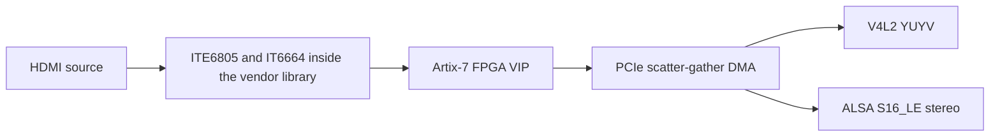
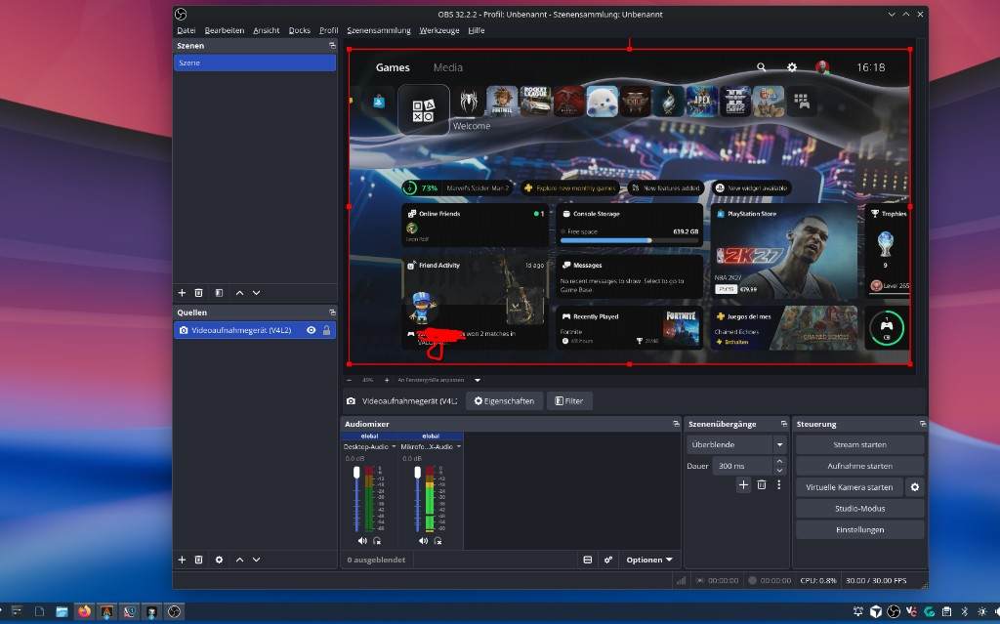

# AVerMedia GC573 Linux driver (Live Gamer 4K)

[](#current-status)
[](#hardware-and-kernel-compatibility)
[](#reverse-engineering)
[](#legal)

Community-maintained Linux driver for the AVerMedia Live Gamer 4K (GC573), PCI `1461:0054`, subsystem `1461:5730`. The module is `cx511h`. It is a V4L2 video capture and ALSA HDMI-audio capture driver. It builds on 6.19.x–7.x; the hardware sessions written down here are kernel 7.2.8 and 7.2. AVerMedia does not publish a current Linux driver for this card, so this tree ports the vendor stack and patches the precompiled library where the stock code cannot do what the hardware can.

**What works, on the vendor-library driver:** the maintainer has confirmed 2560×1440 at 120.35 Hz on a PlayStation 5, captured in OBS and measured with `v4l2-ctl`. 1080p60 on that same PS5, native 4K YUYV, and 16-bit stereo LPCM are documented separately. See [Who tested what](#who-tested-what) for which result belongs to which machine.

**What this is not:** those results come from `cx511h` linked against `AverMediaLib_64.a`. A native port without that library is work in progress and is not what the tests above describe.

**Last aligned with the code:** 2026-10-10.

> [!NOTE]
> The build links `AverMediaLib_64.a` from the repository root (~565 KB). The Makefile copies it to `driver/AverMediaLib_64.o` and then runs `patch_edid.py`, `patch_framerate.py`, and `patch_redzone.py`. Redistribution of that library is not the same question as the MIT license on the maintainer's source. See [Legal](#legal).

> [!NOTE]
> Rebuild after every kernel upgrade. `vermagic` must match `uname -r` (`modinfo cx511h`).

## Contents

- [Current status](#current-status)
- [Who tested what](#who-tested-what)
- [Test matrix](#test-matrix)
- [Hardware and kernel compatibility](#hardware-and-kernel-compatibility)
- [Limitations and safety](#limitations-and-safety)
- [Quick start](#quick-start)
- [Build configuration and EDID modes](#build-configuration-and-edid-modes)
- [Capture examples](#capture-examples)
- [1440p120 capture](#1440p120-capture)
- [Native 4K capture](#native-4k-capture)
- [Development history](#development-history)
- [DMA, IRQ, and the descriptor ring](#dma-irq-and-the-descriptor-ring)
- [stream_on and probe](#stream_on-and-probe)
- [FPGA register reference](#fpga-register-reference)
- [Troubleshooting](#troubleshooting)
- [Module parameters](#module-parameters)
- [Architecture](#architecture)
- [Known issues](#known-issues)
- [Reverse engineering](#reverse-engineering)
- [Legal](#legal)
- [Acknowledgements](#acknowledgements)

## Current status

The driver **builds** on 6.19.x–7.x with matching headers. Hardware capture written down in this file is kernel **7.2.8** (maintainer, CachyOS, 1080p) and **7.2** (contributor VM, Arch GCC, 4K and audio). No 6.19 capture session is recorded. There is no portable prebuilt `.ko`. Build on the machine that will load it.

| Area | Status | Notes |
|:---|:---:|:---|
| Build / load | yes | `./build.sh LLVM=1 CC=clang`, then `sudo ./insmod.sh` |
| Reload / unload | yes | `insmod.sh` delegates to `unload.sh` when the module is already loaded. The teardown page fault that wedged the module is fixed ([Phase 5](#phase-5-continuous-capture-and-audio)) |
| Probe | yes | No hard freeze when the I2C IRQ is acknowledged only while a waiter exists |
| HDMI lock | yes | Default EDID mode is `GC573_EDID=1440p120`. Alternatives: `1080p`, `vendor` |
| Streaming path | yes | `iTE6805_Hardware_Init()` once at probe. `stream_on` is MMIO / FPGA only |
| DMA to userspace | yes | vb2 `q->dev` binding and `dma_sync_*` on buffer done |
| 1080p picture | yes | Maintainer, PS5, OBS, 2026-09-30. YUYV 1920×1080 at 60 fps |
| 1440p120 | yes | Maintainer, own PS5. 2560×1440 at 120.35 Hz, OBS and `v4l2-ctl`. See [1440p120](#1440p120-capture) |
| 4K capture | yes, contributor | YUYV 3840×2160, 24–60 Hz sources captured at 60 fps. [Lou Perret](#who-tested-what), VM, `GC573_EDID=vendor`, `normalize_timing=0` |
| Audio | yes, scoped | 16-bit stereo LPCM at 32 / 44.1 / 48 kHz. PS5 stereo in OBS is the maintainer's result. The THD+N figure is the VM loopback |
| Daily capture | usable, not finished | `v4l2-ctl`, ffmpeg, and OBS work on the tested path. HDCP sources do not. Kernel cmdline requirements below are part of loading this module |



## Who tested what

Three result sets are easy to mix together. They are not the same session.

### Maintainer, real hardware

[Everlite](https://github.com/Everlite), CachyOS, Intel Z690, PlayStation 5 with HDCP off.

- **2026-09-30, kernel 7.2.8.** First picture. The card locked `1920×1080` YUYV at 60 fps on `/dev/video2`. OBS Studio 32 showed the PS5 home screen through a V4L2 source. Two captured frames differed and were not the old constant filler (`10 80` / `80 10`). That image is the 1080p session, not the later 1440p120 run.


- **2026-10, 1440p at 120.35 Hz.** Confirmed by the maintainer on this PlayStation 5. Games cited: Fortnite Creative and The Finals. OBS showed the picture as Rec. 709 SDR with HDR off on the console, and stereo ALSA audio was usable. `v4l2-ctl --stream-mmap` reported a steady **120.35 Hz**. That number is the streaming rate. Dropped V4L2 buffers were not counted separately, and neither was a unique-frame tally. Details are in [1440p120 capture](#1440p120-capture). The kernel version of that session is not written down.

| Check | Recorded? |
|:---|:---|
| 2560×1440 at 120.35 Hz on the maintainer's PS5 | yes, streaming rate |
| HDMI receiver pixel clock around 419840 (about 420 MHz), under the 483.40 MHz EDID timing | yes |
| FPGA `0x1010 = 0x000cba31`, published as about 119.89 Hz | yes. `100000000 / 834097 ≈ 119.89`, the same 100 MHz base `get_audioinfo()` uses for `0x10a0`. The repository does not state that `0x1010` runs from that clock |
| Picture in OBS, Rec. 709 SDR, stereo audio | yes |
| Dropped V4L2 buffers counted | not logged |
| Separate count of unique frames | not logged |
| How long the capture was left running | not logged |

### Contributor, VFIO virtual machine

[Lou Perret](https://github.com/lou-perret), kernel 7.2, Arch, GCC build, GC573 passed through VFIO. Source was an HDMI loopback from an AMD GPU (SMPTE bars and a 1 kHz tone), not a PS5. Pull requests [#7](https://github.com/Everlite/Avermedia-GC573-Linux/pull/7) and [#8](https://github.com/Everlite/Avermedia-GC573-Linux/pull/8) are the capture and audio work that turned DMA filler into a watchable picture.

Recorded there:

- SMPTE bars, mean absolute error 0.3/255 against the reference
- 6000 frames at 60 fps without an oops
- 1 kHz tone at 48 kHz, THD+N −76 dB, no dropout
- Combined A/V with `v4l2-ctl` and ALSA
- Native 4K: 3840×2160 YUYV at source rates 24, 25, 30, 50, and 60 Hz, captured at 60 fps (the FPGA repeats frames when the source is slower). A 4K60 moving pattern gave **120/120 unique frames**. RGB and YCbCr 4:2:0 colours were correct

Do not attribute the THD+N number or the 4K unique-frame count to the PS5 machine.

### Native driver

Work in progress. The results in this file are from `cx511h` and `AverMediaLib_64.a`.

## Test matrix

Unknown cells stay empty of guesses.

| Input | Source rate | V4L2 rate | Format | Audio | App | Machine | Kernel | Method | Unique frames | Owner |
|:---|:---:|:---:|:---|:---|:---|:---|:---|:---|:---|:---|
| 1920×1080 | 60 Hz | 60 fps locked | YUYV | not the measurement of this row | OBS 32 | CachyOS, Intel Z690, PS5, HDCP off | 7.2.8 | V4L2 source; two frames compared by hand | two frames differed; not a long count | Maintainer |
| 2560×1440 | 120.35 Hz | 120.35 Hz | YUYV (only format the FPGA delivers) | stereo LPCM, rate follows the source | OBS; `v4l2-ctl --stream-mmap` | Maintainer's PS5, HDCP off, HDR off, CachyOS, Intel Z690 | not recorded for this session | Maintainer confirmed on the PS5 | not logged | Maintainer |
| 3840×2160 | 24, 25, 30, 50, 60 Hz | 60 fps (repeats below 60) | YUYV | not part of the 4K unique-frame note | `v4l2-ctl` | VFIO VM, HDMI loopback from an AMD GPU | 7.2 Arch, GCC | `GC573_EDID=vendor`, `normalize_timing=0` | 120/120 on a 4K60 moving pattern | Lou Perret |
| SMPTE bars, loopback | 60 Hz | 60 fps, 6000 frames | YUYV | 48 kHz S16_LE, 1 kHz tone, THD+N −76 dB | `v4l2-ctl` + ALSA | same VM | 7.2 | bit-exact bars, MAE 0.3/255 | bars match the reference; not a motion count | Lou Perret |
| iPhone / MacBook, HDCP on | — | picture arrives encrypted | — | — | — | both environments, as noted in Phase 5 | — | visual | garbled, split, or green | both; unsolved |

## Hardware and kernel compatibility

| Item | Value |
|:---|:---|
| Card | AVerMedia Live Gamer 4K, GC573, board CL511H |
| PCI | `1461:0054`, subsystem `1461:5730` |
| Module | `cx511h` |
| Video node | whichever `/dev/videoN` `insmod.sh` prints. The name matches `CL511H` or `AVerMedia`. It is often not `/dev/video0` |
| ALSA card | `AVerMedia CL511H`. Capture device in the examples: `hw:CL511H` |
| Pixel format | YUYV only. The FPGA ignores `vip_cfg.pixel_format` |
| Kernels | Builds on 6.19.x–7.x. Hardware sessions on record: 7.2.8 (maintainer, 1080p) and 7.2 (contributor VM). The 1440p120 kernel was not written down. No 6.19 capture log |

### Kernel command line

On CachyOS 7.2 with `CONFIG_X86_KERNEL_IBT=y` the following is required to load this module. It is not a general recommendation for other machines, and `ibt=off` turns off a control-flow integrity check for the whole kernel.

```text
ibt=off intel_iommu=on iommu=pt
```

- `ibt=off` — the module is built with `-fcf-protection=none`, and the vendor library has no ENDBR64. `MODULE_INFO(ibt, "N")` does not stop the kernel from requiring ENDBR on `init_module`. Without this, `insmod` dies in `init_module` with `kernel BUG at arch/x86/kernel/cet.c`.
- `intel_iommu=on iommu=pt` — on Intel, `iommu=pt` alone does not enable the IOMMU. Passthrough is what the DMA path expects. On AMD, `iommu=pt` is enough when the IOMMU is already on.

### Build tools

Matching kernel headers, a Clang toolchain (`LLVM=1 CC=clang` is the tested combination; the VM results used GCC), and Python 3 for the three patch scripts. Userspace checks need `v4l2-ctl` (v4l-utils). Playback examples use ffmpeg. Nothing here was re-run as part of editing this file.

## Limitations and safety

These are the operations that have hard-frozen the machine, dropped the FPGA off the bus, or stalled capture. They are not tuning knobs.

| Action | Result |
|:---|:---|
| `hdmirxwr()` or any ITE6805 **write** during `stream_on` | Hard freeze. Negotiation belongs at probe |
| Manual `pci_model_mmio_write(0x1040, …)` after the blob has programmed CSC | Corrupt or all-zero frames |
| `0x304 ← 0x07` at `stream_on` (arm descriptor slots before the ring is ready) | Hard freeze |
| Any board-side write to `0x304`, or ACK of `0x10`, while streaming | Clears the slot-arm bits the blob set. Capture stalls |
| Writing a V4L2 frame address into `0x308` | Wrong register. `0x308` is the descriptor **chain** pointer |
| Streaming with no frame size (older builds, no `S_FMT`) | Zero-length DMA descriptors. The FPGA falls off the PCIe bus (`0xffffffff` MMIO) and the host resets |
| Linking the library without `patch_redzone.py` | Interrupts corrupt about 80 leaf functions. The observed oops was `0x297 + 0x58` (`0x297` is RFLAGS) |
| Driving FPGA GPIO pin 5 low (`led_pin_b`) | Drops HDMI hot-plug. Default is `-1` |
| `reg_write` | Raw BAR0 writes. Not a setup step |
| `gst_1.0_raw_video*.sh` | Legacy. Use `v4l2-ctl` |

The physical LED is not a signal indicator. `cx511h_set_led_color()` toggles FPGA GPIO pins 3/4/5 through `aver_xilinx_set_gpio_output()`, and those pin numbers are unconfirmed guesses. The LED flashes red regardless of lock. Trust the `dmesg` lock line.

HDCP is unsolved. Encrypted sources do not get a clean copy-protection frame.

## Quick start

The default build is the **1440p120** path (`GC573_EDID=1440p120`). That is the configuration confirmed at 2560×1440 and 120.35 Hz on the maintainer's PS5. Native 4K is a different build: `GC573_EDID=vendor`, then load with `normalize_timing=0`. Commands for both are below; the 4K block is [further down](#native-4k).

```bash
./build.sh LLVM=1 CC=clang
modinfo cx511h.ko | grep vermagic          # must match `uname -r`
sudo ./insmod.sh                           # prints the V4L2 node it found
```

`insmod.sh` loads `videobuf2_dma_*` if needed and inserts `./cx511h.ko` from the project root. If `cx511h` is already loaded it calls `./unload.sh` first, instead of `rmmod -f`.

Wait until dmesg shows a lock. With the default 1440p120 EDID a PS5 that has chosen 1440p reports that size, not 1080p:

```text
cx511h_ite6805_event locked fe 2560x1440 …
```

The older 1080p-max EDID (`GC573_EDID=1080p`) still locks as `1920x1080p`. `(raw)` on that line is the physical timing from the ITE6805. Open the device only after it appears.

```bash
v4l2-ctl --list-devices
dmesg | grep -iE 'cx511h-phase4|cx511h-scale|cx511h-dma|cx511h-fps|gc573-payload|gc573-handoff|ite6805_event locked|ITE6805_LOCK|cx511h-edid|cx511h-color'
```

Unload and reload without touching PCI remove:

```bash
sudo ./unload.sh     # stops capture and audio holders, then rmmod
sudo ./reload.sh     # unload.sh, then insmod ./cx511h.ko
```

`unload.sh` does not write `/sys/bus/pci/devices/…/remove`. That fallback used to leave the module in `MODULE_STATE_GOING` with `refcnt -1`. If unload exits 3, the module is wedged and only a reboot recovers it. `install.sh` copies an already-built `cx511h.ko` to `/lib/modules/$(uname -r)/kernel/drivers/media/avermedia/` and runs `depmod`. Loading from this tree is still `sudo ./insmod.sh`, which inserts `./cx511h.ko`.

## Build configuration and EDID modes

`driver/Makefile` sets `GC573_EDID ?= 1440p120`. Pass the variable through `build.sh`.

| `GC573_EDID` | What `patch_edid.py` does |
|:---|:---|
| `1440p120` (default) | Finds the vendor 144 Hz detailed timing (`fc 7e …`) inside the library and replaces that 18-byte DTD with 2560×1440 @ 120.00 Hz, CVT-RB, 483.40 MHz (`d4 bc 00 a0 …`). Recomputes the extension-block checksum. Does not replace the whole EDID |
| `1080p` | Overwrites ITE6805 `Default_Edid_Block` / `Fix_Edid_Block` and both IT6664 tables with a checksum-correct 1080p-max EDID (LPCM 2-channel 32/44.1/48 kHz, speaker allocation, HDMI VSDB). This is the Phase 4/5 path |
| `vendor` | Skips `patch_edid.py`. Required for the native 4K results. `patch_framerate.py` and `patch_redzone.py` still run |

`patch_framerate.py` changes the 60 FPS clamp in `aver_xilinx_vip_set_framerate` from a conditional `jle` (`7e 07`) to an unconditional `jmp` (`eb 07`), so a target above 60 can be written to FPGA `0x1080[31:16]`. `patch_redzone.py` rewrites `push %rbp; mov %rsp,%rbp` to `enter $0x100,$0` and `pop %rbp` to `leave` in the library's leaf functions.

The HPD pulse after init is `edid_force_hpd` (default 1). It does not itself select 1080p. It drops and raises hot-plug so the source re-reads whichever EDID was just programmed. The source caches EDID until that pulse or a cable replug.

## Capture examples

Replace `videoX` with the node `insmod.sh` printed.

### 1440p120 (default build)

```bash
sudo v4l2-ctl -d /dev/videoX \
  --set-fmt-video=width=2560,height=1440,pixelformat=YUYV \
  --stream-mmap=4 --stream-count=300
```

That prints the streaming rate. It does not prove the frames are unique. To see whether the bytes are a real picture:

```bash
sudo v4l2-ctl -d /dev/videoX \
  --set-fmt-video=width=2560,height=1440,pixelformat=YUYV \
  --stream-mmap=3 --stream-count=1 --stream-to=/tmp/frame.raw
python3 -c "
d=open('/tmp/frame.raw','rb').read()
print('bytes', len(d), 'unique', len(set(d[:1_000_000])))
"
xxd /tmp/frame.raw | head -4
```

| First bytes | Meaning |
|:---|:---|
| `00 00 00 00…` | Stale cache, wrong CSC path, or no DMA |
| `10 80 10 80…` | UYVY idle fill (Y=128). DMA ran, no picture. This was the Phase 4b failure; it is not the current 1080p/1440p result |
| `80 10 80 10…` | YUYV order of that same fill |
| many distinct values | Pixel data is present. A single frame still says nothing about 120 unique frames |

OBS: V4L2 source, device from `--list-devices`, YUYV, 2560×1440. Restart the source after a mode change. `stream_on` is ignored while a stream is already running.

### 1080p60

```bash
./build.sh LLVM=1 CC=clang GC573_EDID=1080p
sudo ./reload.sh
sudo v4l2-ctl -d /dev/videoX --set-fmt-video=width=1920,height=1080,pixelformat=YUYV \
  --stream-mmap=3 --stream-count=1 --stream-to=/tmp/frame.raw
ffplay -f v4l2 -input_format yuyv422 -video_size 1920x1080 -framerate 60 /dev/videoX
```

`normalize_timing=1` (the default) only rewrites readback that is 1920×1080 but not a plausible 1080p60 clock. It does not force a 1440p lock down to 1080p.

### Audio

The PCM is S16_LE, exactly 2 channels, 32 / 44.1 / 48 kHz, and the rate is locked to the FPGA measurement when the device is opened. There is no compressed-audio passthrough.

```bash
ffmpeg -f alsa -ch_layout stereo -sample_rate 48000 -i hw:CL511H -t 5 /tmp/audio.wav
```

PipeWire often holds the PCM and pins the module `refcnt` at 1. `unload.sh` is what releases it. A source that changes mode while the PCM is open (Discord has done this) stops audio until capture is restarted. That case is still open.

### Native 4K

```bash
./build.sh LLVM=1 CC=clang GC573_EDID=vendor
sudo ./unload.sh
sudo insmod ./cx511h.ko normalize_timing=0
sudo v4l2-ctl -d /dev/videoX \
  --set-fmt-video=width=3840,height=2160,pixelformat=YUYV \
  --stream-mmap=4 --stream-count=60 --stream-to=/tmp/4k.yuyv
```

`normalize_timing` must be 0. Left at 1, a 1080p-shaped misread is forced to 1080p60 and the 4K path is not the one that was tested. There is no hardware 4K→1080p downscale: clip and scaler are programmed with the output size, so capture at the source size.

## 1440p120 capture

Confirmed by the maintainer on a PlayStation 5: 2560×1440 at 120.35 Hz through `cx511h`. It is not an EDID-only claim. The native port is still work in progress.

The 60 FPS ceiling had more than one cause. All of the following are in the current default build.

| # | What was wrong | What the code does now |
|:---|:---|:---|
| 1 | Vendor EDID had no 1440p120 detailed timing the PS5 would take | `patch_edid.py` in mode `1440p120` replaces the 144 Hz DTD with an 18-byte 2560×1440 @ 120 Hz CVT-RB timing, pixel clock 483.40 MHz, and fixes the CEA checksum |
| 2 | `aver_xilinx_vip_set_framerate` clamped the rate to 60 before writing `0x1080[31:16]` | `patch_framerate.py` turns that `jle` into `jmp` |
| 3 | ITE6805 under-reads both clock and frame rate. A 1440p120 signal has been seen near 413 MHz / 100 fps in the snap tests, and the session note records `pclk=419840` | `cx511h_true_framerate()` in `board_v4l2.c` rescales against the nearest standard clock and snaps. 80–92% of 483400 kHz maps toward 120. The self-check includes `cx511h_true_framerate(100, 413228) == 120` and `(102, 411856) == 120`. A value that is already 24, 25, 30, 50, 60, 120, 144, or 240 is not scaled again |
| 4 | `VIDIOC_G_PARM` clamped at 60 | `v4l2_model_ioctl_g_parm()` reports the configured output rate or the detected input rate |
| 5 | FPGA `0x103c` (`VIP_FRAME_PERIOD`) stayed at 2,475,000 cycles, which is `148500000/60`, so the VIP kept a 60.31 FPS gate even after `0x1080` said 120 | At `stream_on`, if `override_reg_103c <= 0`, the driver writes `0x103c = 148500000 / target_fps`. For 120 that is 1,237,500 (`0x0012e1fc`). `override_reg_103c > 0` writes that cycle count instead |

Registers written for the verified 120 Hz session:

| Register | Value | Role |
|:---|:---|:---|
| `0x1080[31:16]` | 120 | Target frame rate, after the unclamp |
| `0x1088` | `0x3` | DDR dual-pixel |
| `0x103c` | `0x0012e1fc` (1,237,500) | Frame period at a 148.5 MHz timebase |
| `0x1010` | `0x000cba31` | VSYNC cycle count, published as ~119.89 Hz |

`stream_on` also logs `[cx511h-fps]` with the `0x103c` value before and after the write. That log is the check that the period took effect.

The advertised EDID clock (483.40 MHz) and the receiver's readback (~420 MHz, and ~413 MHz in the unit tests) are different numbers on purpose. The receiver under-reads; the snap exists because of that. Do not "correct" the EDID down to the readback or the PS5 will stop offering 120 Hz.

## Native 4K capture

Contributor result. Build and load as in [Capture examples](#capture-examples). Do not use this section as the maintainer's PS5 result.

| # | Problem | Fix |
|:---|:---|:---|
| 1 | Dual-pixel and TTL decisions compared an ITE6805 clock in kHz with 170000000 Hz, so 4K never selected `2X24_INTERLEAVE` | `cx511h_pclk_khz()`; the threshold is `CX511H_DUAL_PIXEL_PCLK_KHZ` (170000) |
| 2 | Frame rate under-read by the same factor (26 fps on 2160p30, 51 on 1080p60) | `cx511h_true_framerate()`, nearest standard clock. A rate left at 26 makes the FPGA duplicate frames up toward 50 |
| 3 | FPGA registers are not readable from userspace while the driver owns BAR0 | `reg_read` parameter |

24 and 25 Hz sources are captured at 60 fps by frame repeat. The integer measurement can report 24 for a 25 Hz source. RGB and YCbCr 4:2:0 were checked in the VM. YUYV is still the only captured pixel format.

## Development history

Phases are chronological. Later phases close items that earlier sections describe as open. The early sections are kept because the failure mode and the fix are the useful part, not because the bug is still present.

| Phase | Status | Summary |
|:---|:---:|:---|
| 1 — bring-up | done | Kernel port, probe, FPGA and ITE6805 attach |
| 2 — DMA / IRQ | done | V-DESC hook and the descriptor chain. The `0x304 ← 0x01` doorbell was later found harmful |
| 3 — coherency | done | `q->dev = dev`; cache sync before userspace sees the buffer |
| 4 — stable path | done | No I2C writes at stream time. Boot-time init. Full-size DMA frames. At the time, still filler |
| 4b — picture quality | done, later | TTL format and 1080p60 normalization. Filler remained until Phase 5 |
| 5 — continuous capture and audio | done | Blob owns the ring, red-zone patch, zero-length DMA fix, HDMI audio EDID, ALSA constraints, teardown order |
| 6 — native 4K | done | Clock unit, frame-rate snap, `GC573_EDID=vendor` |
| 7 — 1440p120 | done | EDID DTD, framerate unclamp, `0x103c`. Maintainer's PS5: 2560×1440 at 120.35 Hz |

### Phase 5: continuous capture and audio

VM loopback, kernel 7.2, GCC. This is the phase that made frames real and made `rmmod` survive.

| # | Problem | Fix |
|:---|:---|:---|
| 1 | `rmmod` page fault in `pci_model_mmio_read()`, module wedged (`refcnt -1`) | BARs unmapped only after `cxt_manager_release()` (`pci_model.c`) |
| 2 | FPGA GPIO pin 5 ("blue LED") driven low on lock drops hot-plug. FPGA then sees `size 0x0` | `led_pin_b` defaults to `-1` |
| 3 | FPGA ignores `vip_cfg.pixel_format` and always delivers YUYV | Only YUYV is advertised |
| 4 | `VIDIOC_ENUM_FMT` NULL dereference past the last format | `-EINVAL` before the dereference |
| 5 | No `S_FMT` → frame size 0 → zero-length descriptors → FPGA off the bus | Default 1920×1080; the descriptor loop stops at `remain == 0` |
| 6 | First V-DESC before `START_STREAMING`. `framegrabber_mask_s_status()` called `stream_on` again and `config_video_process()` wiped the ring | `cx511h_dma_streaming`; `stream_on` returns immediately while streaming |
| 7 | Board path wrote `0x304 = 0x01` after every frame and cleared the blob's slot-arm bits. Capture stalled after a few frames | Blob owns the ring (`legacy_doorbell=0`) |
| 8 | `AverMediaLib_64.a` built without `-mno-red-zone`. Interrupts corrupt ~80 leaf functions | `driver/patch_redzone.py` |
| 9 | Injected 1080p EDID had no audio flag and no HDMI VSDB, so sources treated the card as DVI | CEA block rewritten: LPCM 2ch 32/44.1/48 kHz, speaker allocation, VSDB |
| 10 | ALSA advertised S24 and up to 192 kHz with no rate constraint | S16_LE, 32/44.1/48 kHz, rate locked to the FPGA measurement |
| 11 | ~760 kernel log lines per second while streaming | Per-buffer logs behind `dma_debug` |

HDCP was already unsolved in this phase and still is.

### Phase 4: boot-time HDMI bootstrap

**Problem.** Calling `iTE6805_Hardware_Init()` or `hdmirxwr()` from `stream_on` raced the library's own HDMI negotiation and hard-froze the machine (registers `0xc0`, `0x23`, and the streaming chain all showed up in that failure).

**Fix.** One-shot init at the end of `board_probe()` in `board_config.c`:

```text
[cx511h-phase4] Bootstrapping ITE6805/IT6664 hardware pipeline once at probe...
iTE6805_Hardware_Init(ite6805_handle_1);
```

The IT6664 splitter is attached by the library from `ite6805_attach()` → `ite6664_attach()` during `board_i2c_init()`. `ite6664_task` runs on a 500 ms timer inside the library's task model.

**1080p-max EDID (historical default, still available as `GC573_EDID=1080p`).** The library's own tables advertised 4K. A PS5 that locked 4K took the dual-pixel path and produced black frames. The EDID array in `ite6805_EDID.h` is not what the chip loads; the library ships its own copies. `patch_edid.py` mode `1080p` overwrites those copies, and `edid_force_hpd` pulses HPD:

```text
[cx511h-edid] Forcing HPD re-negotiation (EDID is now 1080p-max)...
[cx511h-edid] HPD pulse complete
```

After that renegotiation the observed lock was `1920x1080p`, `dual=0`, `bypass=0`, and full-size DMA buffers arrived. **At this date the payload was still the constant filler.** That filler is closed in Phase 5. It is not the current picture.

**`stream_on` policy.** No ITE6805 register writes. The log line is:

```text
[cx511h-dma] === STREAM ON (MMIO/FPGA only — no I2C) ===
```

If the physical timing from `ite6805_get_frameinfo()` is larger than the V4L2 output, one `aver_xilinx_config_video_process()` call programs the scaler. `vip_cfg.in_videoformat` is the physical size, `out_videoformat` is the V4L2 size, `dual_pixel = 1`, `video_bypass = 0`, and `valid_mask` includes `SCALER_CFG_SHRINK_MASK`. The library writes `0x1088` and `0x1040`. Do not write those two registers again afterwards.

With the default 1440p120 EDID this downscale branch is not the PS5's normal path. It remains as a guard.

**I2C IRQ.** The hardware holds IRQ bit `0x800` (I2C complete) asserted. `pci_model.c` acknowledges it only when `i2c_waiters > 0`. An unconditional ACK starved the library's I2C poll and froze `insmod`.

### Phase 4b: picture quality, as of 2026-08-01

Resolved later by Phase 5. The notes below are the investigation, not an open bug.

On 2026-08-01 the card locked `1920x1080p` with `dual=0`, `bypass=0`, and DMA frames of 4,147,200 bytes (`buffer_prepare` built an 8-fragment SG list, `desc[0..7] = 0x200000 … 0x1000`). Every frame was still filler: `unique bytes ≈ 3`, set `{0, 0x10, 0x80}`, hex `10 80 10 80 …` (UYVY, Y=128, U/V=16/0). That pattern is a video-idle fill, not HDMI pixels.

The TTL output format (the parallel bus into the FPGA) was chosen in `ITE6805_LOCK` from `fe_frameinfo->packet_colorspace`. The library leaves that field at `CS_YUV (0)` even when the PS5 is sending RGB. Combined with a forced 1080p clock of 148500000, which is below 170000000, the code took the `else` branch and wrote `ITE6805_OUT_FORMAT_SDR_ITU656_24_MODE0`. The FPGA then ingested RGB as YUV.

**Fix, still in `board_v4l2.c`.** The TTL format follows `ite6805_get_colorspace()` (`0` YUV, `1` RGB limited, `2` RGB full). RGB at a low pixel clock uses `ITE6805_OUT_FORMAT_SDR_444_24` (`0x40`) instead of ITU-656.

The ITE6805 timing readback is also wrong: `pixel_clock` around 124952–126457 and `fps_in=51` for a real 1080p60 (148500 kHz / 60). Because the active size really is 1920×1080, a `width > 1920` override never ran. Both overrides are gated by `normalize_timing` (default 1, runtime `/sys/module/cx511h/parameters/normalize_timing`):

1. **Deferred TTL re-assert.** `ITE6805_LOCK` runs before the AVI infoframe settles, so `ite6805_get_colorspace()` / `get_sampingmode()` are still unstable there (`eff_cs=0`, `sampling=4`). `check_signal_stable_task`, about 1.5 s after lock, writes the format again and logs `[cx511h-ttl] check_signal_stable_task: eff_cs=%u sampling=%u -> out_format=0x%02x`. The PS5 case that was confirmed is `eff_cs=1 sampling=0 → out_format=0x40`. Those I2C writes are in the task, not in `stream_on`.
2. **1080p60 normalization**, two different widths:
   - In `ITE6805_LOCK`, a 1920×1080 input whose readback is not valid 1080p60 is forced to `width/height=1920×1080`, `framerate=60`, `denominator=1`, `pixel_clock=148500000`, `dual_pixel=0`, `dual_pixel_like=0`, `sampling_mode=0`, `ddr_mode=0`.
   - In `stream_on`, only `pixel_clock=148500000` and `fps=60` are corrected. `out_videoformat`, `clip_size`, `dual_pixel`, and `in_ddrmode` are left to the size and clock logic. Forcing `in_ddrmode` there was associated with V-DESC stopping entirely.
   - Vendor naming: `vactive` is the horizontal width and `hactive` is the vertical height, so 1920×1080 is `vactive=1920 && hactive=1080`.

Confirmed at that point, and still true:

- The V-DESC hook shows real transfers: `slot N: chain ptr 0x308=0x67ce0000 … desc_count 0x310=0x000000NN`. `0x310` matches the SG fragment count. `0x308` is the library's chain address, not the frame buffer. The library re-arms slots on the *next* V-DESC, so `0x308 == 0` immediately after `enable_video_streaming(TRUE)` is not a failure.
- `[cx511h-color] AUTO(src): RGB Limited BT709` (`in_colorspacemode=1`, `in_packetsamplingmode=0`).

The Windows driver (`FUN_140045168`) programs ITE6805 CSC registers `0x6b` / `0x6c` / `0x6e` and a 22-byte table at `0x70` from the AVI infoframe, and sets `0x6c=0` to bypass CSC for RGB→RGB. This driver has no direct I2C write for those registers. The library exposes getters and `ite6805_set_out_format`. FPGA colour is `vip_cfg.currentCSC`. The TTL-bus choice is the driver-side equivalent that was available.

**State on 2026-08-01, closed afterwards.** Filler remained after the TTL and timing fixes, so colour was ruled out as the only blocker. A continuous V-DESC series during a locked, normalized stream had not been seen yet (single transfers around lock, and a session with `in=0x0 ddr=1` that did show a valid `0x308`). The suspects at the time were the unload hang, an early hex dump (`AVER_LIVE_HEX_DUMP` was gated at frame 100), `normalize_timing` versus `ddr_mode`, the scaler clip window, and `0x300` advancing across frames. Phase 5 is what actually cleared the stall: ring ownership, the red zone, and not driving pin 5.

### Phase 3: DMA coherency

Still required. It is not sufficient on its own.

| Fix | File |
|:---|:---|
| `q->dev = dev` on the vb2 queue | `v4l2_model_videobuf2.c` |
| `v4l2_model_sync_pending_plane_for_cpu()` before the buffer is handed to userspace | called from `cx511h_video_buffer_done()` |
| No CPU byte-swap of a buffer the device still owns | swap removed from `v4l2_model_buffer_done()` |

Without `q->dev`, `dma_sync_*` is skipped and the CPU reads stale zeros. That is the classic green frame. A correct sync does not fix a source that never locked, which is why Phase 4b still saw filler after this landed.

## DMA, IRQ, and the descriptor ring

The library programs and arms descriptor slots. The board code prepares SG lists and returns buffers. `legacy_doorbell=1` also writes `0x304=0x01` and ACKs `0x10` from the board path, which stalls capture. Leave it at 0.

Per frame: V-DESC IRQ → library `aver_xilinx_irq_func()` (clears the completed slot bit, ACKs `0x10`) → video DPC → `cx511h_video_buffer_done()` → handoff guard → `dma_sync_*` → `v4l2_model_buffer_done()`. The library then kicks the next ready list.

`stream_off` is `aver_xilinx_enable_video_streaming(FALSE)` only.

Chain entry, 16 bytes: `[0]` and `[1]` are the target address, `[2]` is the size in dwords, `[3]` is the control word `0x80006000`.

## stream_on and probe

`cx511h_stream_on()` in `driver/board/cx511h/board_v4l2.c`:

1. Read-only library calls: `ite6805_get_frameinfo()`, `get_workingmode()`, `get_colorspace()`, `get_sampingmode()`.
2. Build `vip_cfg` from the physical input, the V4L2 output, and the colours (`force_input_mode` can override).
3. If `normalize_timing` is set and the input is 1920×1080 with a bad 1080p60 readback, force `pixel_clock=148500000` and `fps=60` only.
4. `aver_xilinx_enable_video_streaming(FALSE)`, then `msleep(50)`.
5. If `fe_frameinfo` is larger than the output, seal `vip_cfg` for the downscale path.
6. `aver_xilinx_config_video_process(&vip_cfg)`. No manual `0x1040`.
7. If `0x1080[31:16]` is not the target fps, write it. Then write `0x103c` as `148500000 / fps`, unless `override_reg_103c > 0`.
8. Optional `override_reg_1088` and `override_scaler_bypass` (`0x1000` bit 7).
9. `msleep(200)`. Optional `debug_pixel_format` / `auto_test_byteorder`.
10. Set `cx511h_dma_streaming`, then `aver_xilinx_enable_video_streaming(TRUE)`.

A second `stream_on` while that flag is set returns immediately. A source that changes resolution mid-capture needs the capture stopped and started again.

`board_probe` order:

1. PCI, I2C manager, GPIO, memory, task manager
2. `aver_xilinx_init` and `aver_xilinx_init_registers`
3. I2C bus, board GPIO, `board_i2c_init` (ITE6805 at 8-bit address `0x58`; the library attaches the IT6664)
4. Bitmap overlay, ALSA, `board_v4l2_init`
5. `iTE6805_Hardware_Init()` once, then the HPD pulse if `edid_force_hpd` is set

## FPGA register reference

| Register | Role |
|:---|:---|
| `0x10` bit `0x2` | V-DESC complete (video frame done) |
| `0x10` bit `0x20` | A-DESC complete (audio chunk done) |
| `0x10` bit `0x800` | I2C engine. ACK only while `i2c_waiters > 0` |
| `0x8` bit `0x2` | Audio enable |
| `0x200`–`0x21c`, `0x2b4`–`0x2c0` | Audio DMA (`start_audio_streaming()`): chunk size, two buffer addresses, channel map |
| `0x10a0` | Audio clock period. Rate = `100000000 / value` (`get_audioinfo()`) |
| `0x300 & 7` | Active descriptor slot |
| `0x304` bit `0` | Stream run, set by the library in `enable_video_streaming()` |
| `0x304` bits `1..4` | Slot arm bits, `1 << (slot + 1)`, set by `tranfer_desclist()`, cleared by `irq_func()` |
| `0x308 + n·0xc` | Descriptor chain bus address, low. Not the frame buffer |
| `0x30c + n·0xc` | Descriptor chain bus address, high |
| `0x310 + n·0xc` | Descriptor count (SG fragments, for example `0x7`). Not a byte length |
| `0x1000` bit `0x80` | Scaler enable. `override_scaler_bypass` drives this |
| `0x1010` | VSYNC cycle counter used in the 1440p120 notes |
| `0x103c` | `VIP_FRAME_PERIOD`. Cycles = `148500000 / fps` |
| `0x1040` | CSC and dual-pixel. Programmed by the library at `config_video_process` |
| `0x1080[31:16]` | Target frame rate |
| `0x1088` | Ingest / working mode. Session value `0x3` is DDR dual-pixel. `override_reg_1088`: 0 SDR 1px, 1 SDR 2px, 2 DDR 1px, 3 DDR 2px |

## Troubleshooting

```bash
dmesg | grep -iE 'cx511h-phase4|cx511h-scale|cx511h-dma|cx511h-fps|cx511h-ttl|cx511h-color|cx511h-edid|ite6805_event locked|gc573-payload|gc573-handoff|gc573-chain'
```

| Symptom | Where to look |
|:---|:---|
| `insmod` BUG in `arch/x86/kernel/cet.c` | `ibt=off` is missing on an IBT kernel |
| Insmod hangs, no lock line | I2C ACK must stay opt-in. Do not ACK `0x10` bit `0x800` unconditionally |
| Lock line never arrives | EDID not re-read. Replug HDMI, or confirm `[cx511h-edid]` and `edid_force_hpd=1` |
| PS5 offers 1440p but not 120 Hz | Build must be `GC573_EDID=1440p120` (the default), not `1080p` or a half-patched library. The source caches EDID until HPD or a replug |
| Stream stuck near 60.31 FPS while the source is 120 Hz | `[cx511h-fps]` should show `0x103c` rewritten to `148500000/fps`. A leftover 2,475,000 means the period write did not run |
| Constant `10 80` frames | Historical idle fill. Confirm Phase 5 is actually in the loaded module (`led_pin_b=-1`, `legacy_doorbell=0`, red-zone patch log at build time) |
| All-zero frames | Missing `q->dev`, or a manual `0x1040` write after the library |
| Capture runs for a few frames and stops | Something is writing `0x304` or ACKing `0x10` from the board path |
| `rmmod` fails, `refcnt` 1 | PipeWire or another ALSA client. `sudo ./unload.sh` |
| `refcnt -1`, initstate `going` | Teardown wedged. Reboot. Do not echo into the PCI `remove` file |
| Green / split / garbled on a laptop or phone | HDCP. Unsolved |
| GStreamer helper scripts | Do not use them |

Read FPGA registers without a second mapping of BAR0:

```bash
echo 0x300,0x304,0x103c,0x1080,0x1088 > /sys/module/cx511h/parameters/reg_read
dmesg | grep cx511h-reg
```

`reg_write` (`offset=value` pairs) exists and can wedge the card. It is not part of setup.

## Module parameters

| Parameter | Default | Description |
|:---|:---:|:---|
| `edid_force_hpd` | 1 | Pulse HPD after `iTE6805_Hardware_Init()` so the source re-reads the EDID that was patched at build time. 0 skips the pulse. The parameter does not choose the EDID mode |
| `force_input_mode` | 0 | 0 auto, 1 YUV422, 2 YUV444, 3 RGB full, 4 RGB limited |
| `normalize_timing` | 1 | When the input is 1920×1080 and the ITE6805 readback is not a valid 1080p60, force `pixel_clock=148500000` and `fps=60`. Runtime: `/sys/module/cx511h/parameters/normalize_timing`. **Set 0 for native 4K** |
| `debug_pixel_format` | -1 | -1 auto. 0–3 force a YUV byte order |
| `auto_test_byteorder` | 0 | Cycle formats on `stream_on` (MMIO peek) |
| `no_signal_pic` | NULL | Bitmap path when there is no signal |
| `copy_protection_pic` | NULL | Bitmap for HDCP. The insmod name is the upstream typo `copy_protetion_pic` (missing `c`) in `board_config.c` |
| `led_pin_r` / `led_pin_g` | 3 / 4 | GPIO pins passed to the library. -1 disables. Wiring to the real LED is not verified |
| `led_pin_b` | -1 | Pin 5 is not a blue LED. Driving it low drops HDMI hot-plug |
| `override_reg_1088` | -1 | FPGA `0x1088`. -1 leaves the library value. 0 SDR 1px, 1 SDR 2px, 2 DDR 1px, 3 DDR 2px |
| `override_reg_103c` | -1 | FPGA `0x103c` cycle count. -1 or 0 writes `148500000/fps`. A positive value is written as-is |
| `override_scaler_bypass` | -1 | -1 auto. 0 sets `0x1000` bit 7 (scaler on). 1 clears it (bypass) |
| `legacy_doorbell` | 0 | 1 also writes `0x304=0x01` and ACKs `0x10` from the board path. That stalls capture |
| `dma_debug` | 0 | 1 logs every descriptor list built in `buffer_prepare` |
| `reg_read` | — | Write-only. `echo 0x300,0x304 > /sys/module/cx511h/parameters/reg_read` |
| `reg_write` | — | Write-only raw BAR0 stores. Can freeze the machine. Not a configuration interface |

## Architecture

| Layer | Path | Role |
|:---|:---|:---|
| Entry | `driver/entry.c` | Module init, PCI IDs |
| Board | `driver/board/cx511h/board_config.c` | Probe, one-shot HDMI init, HPD pulse |
| Board | `driver/board/cx511h/board_v4l2.c` | V4L2, `stream_on`, timing snap, `0x103c` / `0x1080`, buffer done |
| Board | `driver/board/cx511h/board_alsa.c` | Card name `AVerMedia CL511H`, rate query from the FPGA |
| PCI | `driver/utils/pci/pci_model.c` | MMIO, V-DESC hook, opt-in I2C ACK |
| V4L2 | `driver/utils/v4l2/` | videobuf2, framegrabber, cache sync, `G_PARM` |
| ALSA | `driver/utils/alsa/alsa_model.c` | S16_LE, 2 channels, 32/44.1/48 kHz |
| Library | `AverMediaLib_64.a` | ITE6805, IT6664, `aver_xilinx`, scaler. Not MIT source |
| EDID patch | `driver/patch_edid.py` | `1440p120` (default DTD swap) or `1080p` (full table) |
| Framerate patch | `driver/patch_framerate.py` | Removes the 60 FPS clamp on `0x1080` |
| Stack patch | `driver/patch_redzone.py` | Reserves a stack frame in library leaf functions |
| Build | `build.sh`, `driver/Makefile` | Out-of-tree module. Stages to `/tmp` when the source path contains spaces |

| Script | Purpose |
|:---|:---|
| `build.sh` | Clean and build. Forwards arguments (`LLVM=1 CC=clang`, `GC573_EDID=…`). Copies `cx511h.ko` to the repo root |
| `insmod.sh` | Load dependencies and `./cx511h.ko`. Finds the V4L2 node by sysfs name. Reloads via `unload.sh` if already loaded |
| `unload.sh` | Stop capture and audio holders, `rmmod`. No PCI remove. Exit 3 means wedged |
| `reload.sh` | `unload.sh`, then `insmod ./cx511h.ko` |
| `install.sh` | Install the built `.ko` under `/lib/modules/$(uname -r)/kernel/drivers/media/avermedia/` and `depmod` |
| `gst_1.0_raw_video*.sh` | Legacy. Do not use |

## Known issues

1. **HDCP.** Encrypted sources (iPhone, MacBook, protected video) produce a garbled, split, or green picture rather than a clean slate. There is no fix in this tree.
2. **No I2C writes while streaming.** Deliberate. Do not put TTL, unmute, or `hdmirxwr` back into `stream_on` without a new analysis of the freeze.
3. **4K metadata split.** `ITE6805_LOCK` can still force 1920×1080 into the framegrabber for capability reporting while `vip_cfg` uses the physical `fe_frameinfo` for the scaler. With `GC573_EDID=1080p` the source negotiates 1080p. Native 4K needs `GC573_EDID=vendor` and `normalize_timing=0`.
4. **No reconfiguration on a new lock while streaming.** `stream_on` returns immediately while `cx511h_dma_streaming` is set. A mid-capture mode change, including Discord, needs the capture restarted. Audio stopping in that case is still open.
5. **GStreamer scripts** are legacy and have been unsafe. Use `v4l2-ctl`, ffplay, or OBS.
6. **Module refcnt.** An open ALSA PCM holds `refcnt` at 1. `unload.sh` releases PipeWire and WirePlumber. A real wedge (`refcnt -1`, state `GOING`) still needs a reboot.
7. **Audio is 16-bit stereo LPCM only**, at the source rate among 32, 44.1, and 48 kHz. No compressed passthrough, no rate above 48 kHz on this card's PCM.
8. **Suspend and resume** still use the legacy hooks. They have not been moved to `dev_pm_ops`.
9. **`vactive` / `hactive`.** In `vip_cfg`, `vactive` is the width and `hactive` is the height. `fe_frameinfo->width` is stored in `in_videoformat.vactive`. Do not swap them to match V4L2 names without checking the bypass tables.
10. **EDID is a build choice, not a module parameter.** The default build injects 1440p120 into the vendor tables. `GC573_EDID=1080p` is the old 1080p ceiling. `GC573_EDID=vendor` is required for 4K. There is no 4K→1080p scaler path that was tested, and a 25 Hz source can be reported as 24.
11. **The library is patched on every build.** Skipping `patch_redzone.py` brings back interrupt corruption. Skipping `patch_framerate.py` brings back the 60 FPS clamp. Skipping `patch_edid.py` (`GC573_EDID=vendor`) keeps the vendor EDID, which is correct for 4K and wrong for the PS5 1440p120 result.
12. **1440p at 120.35 Hz is confirmed** on the maintainer's PS5. A separate unique-frame count and the kernel version of that session were not written down.

## Reverse engineering

The driver was brought up by comparing the Windows driver, disassembling `AverMediaLib_64.a` (`aver_xilinx.o`, `ite6805_sys.o`, `ite6664*.o`), and checking the result on hardware. Parts of that analysis were AI-assisted; the register notes below are only useful where a later capture confirmed them.

Forensic log tags: `[gc573-payload]`, `[gc573-chain]`, `[gc573-handoff]`, `[cx511h-scale]`, `[cx511h-phase4]`, `[cx511h-color]`, `[cx511h-edid]`, `[cx511h-dma]`, `[cx511h-desc]`, `[cx511h-pixfmt]`, `[cx511h-fps]`, `[cx511h-ttl]`, `[cx511h-reg]`.

The frame-period register `0x103c` (`VIP_FRAME_PERIOD`) was identified from the Xilinx Artix-7 FPGA VIP work published with [ostrich/gc555](https://github.com/ostrich/gc555). That is what made a rate above 60 able to pass the FPGA gate, after the library clamp was removed. The GC555 project is a different card and a different license; nothing in this tree copies that driver in.

Local decompiler notes are gitignored (`reference_gc555/`, `do not push do github/`). The native port (`open_gc573/`) is work in progress and is not documentation for `cx511h`.

## Legal

Interoperability work, with the usual reference to Directive 2009/24/EC article 6 for the reverse-engineering claim. This README is not a legal opinion.

| Material | What to assume |
|:---|:---|
| `LICENSE.md` | MIT, copyright 2026 Everlite, for the source that license covers |
| `AverMediaLib_64.a` and the `.o` produced from it | Precompiled vendor library. Not shown to be MIT. The build patches it in place. Check the vendor terms before redistributing a binary |
| `driver/include/it6664_*.h`, `ite6805_*.h`, and similar headers | ITE/AVerMedia headers shipped so the glue can compile. Their notices are not the MIT grant |
| Register and DMA notes in this file | Findings from that library and from the Windows driver. They describe behavior; they are not a second implementation |
| [Pull requests #7 and #8](https://github.com/Everlite/Avermedia-GC573-Linux/pull/7) | Lou Perret's capture and audio changes |

AVerMedia and Live Gamer 4K are trademarks of their owner. This project is not supported by AVerMedia.

> [!CAUTION]
> Do not treat a built `cx511h.ko` as an MIT binary. It contains the patched vendor library.

## Acknowledgements

Maintained by [Everlite](https://github.com/Everlite). Repository: [Everlite/Avermedia-GC573-Linux](https://github.com/Everlite/Avermedia-GC573-Linux).

- [Lou Perret](https://github.com/lou-perret) — continuous capture, audio constraints, 4K measurements, and the VM results in [#7](https://github.com/Everlite/Avermedia-GC573-Linux/pull/7) and [#8](https://github.com/Everlite/Avermedia-GC573-Linux/pull/8)
- [derrod](https://github.com/derrod) — earlier work on the card
- [ostrich](https://github.com/ostrich) — [gc555](https://github.com/ostrich/gc555), in particular the FPGA VIP frame-period register that the 120 Hz path programs

Use at your own risk.
